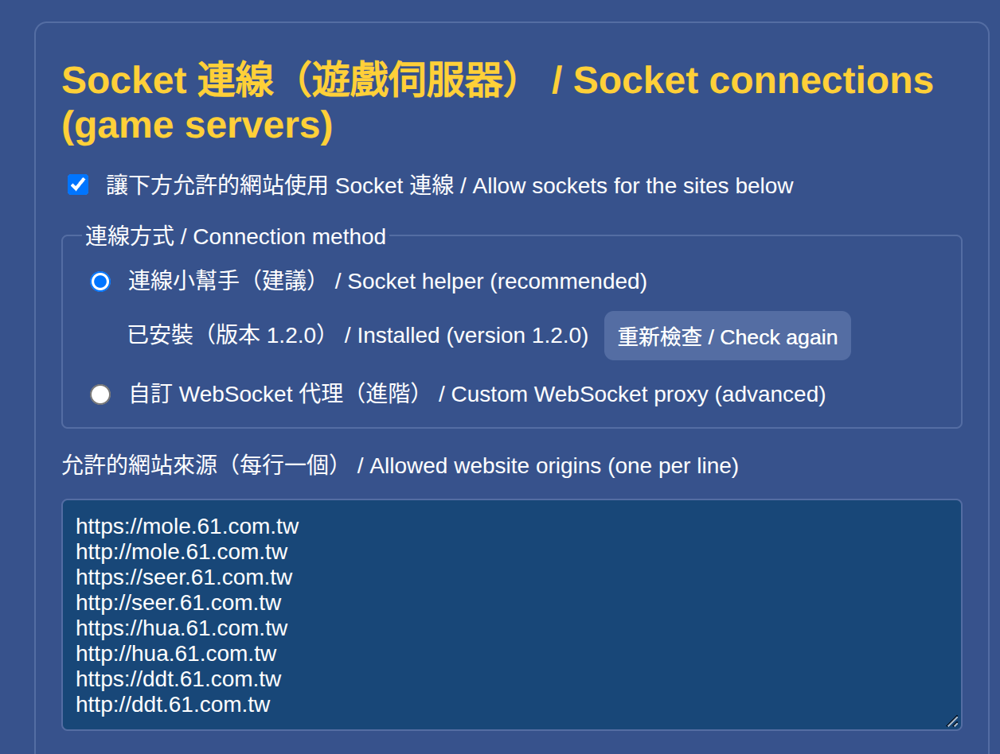
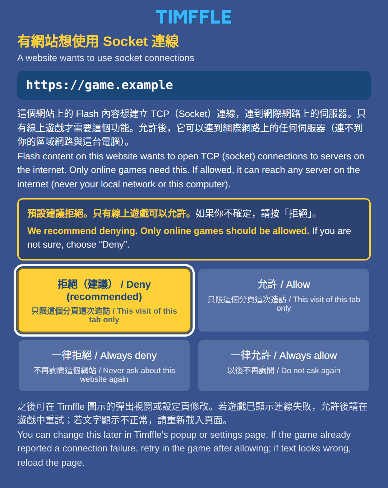
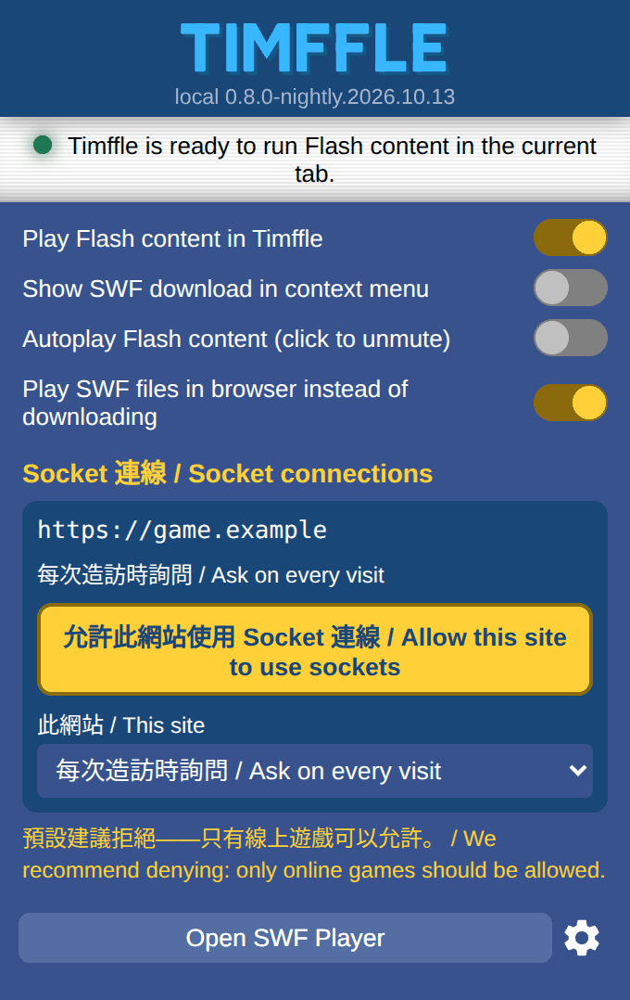
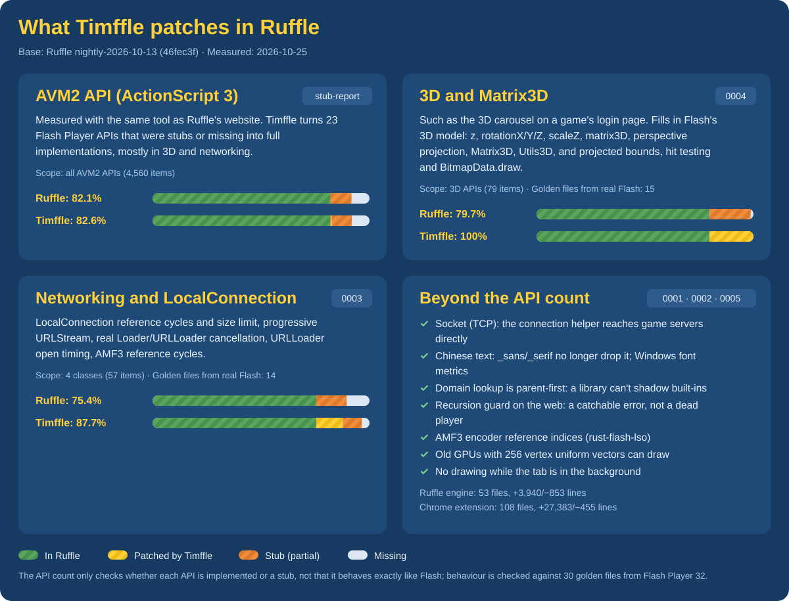

<p align="center">
  
</p>

<h1 align="center">
  
</h1>

<p align="center"><b>Play Flash online games in Chrome again.</b></p>

<p align="center">Ruffle, plus the TCP socket support that Flash online games need.<br>Taomee Taiwan's games work out of the box: 摩爾莊園 ・ 賽爾號 ・ 小花仙 ・ 彈彈堂</p>

<p align="center">
  <a href="https://github.com/Im-Tim-mI/Timffle/releases/latest"><b>Download the latest release</b></a> ・
  <a href="#install">Install</a> ・
  <a href="#troubleshooting">Troubleshooting</a>
</p>

<p align="center"><b>English</b> ・ <a href="README.zh-TW.md">繁體中文</a> ・ <a href="README.zh-CN.md">简体中文</a></p>

<p align="center">Version <code>0.8.0.26308</code> (based on Ruffle nightly 2026-10-13) | licence MIT OR Apache-2.0, at your option</p>

> [!IMPORTANT]
> **Timffle is an unofficial fork of [Ruffle](https://ruffle.rs/). It is not affiliated with, endorsed by or sponsored by the Ruffle project, Ruffle LLC or Taomee.** Almost all of the Flash emulation is the work of Ruffle and its [hundreds of contributors](https://github.com/ruffle-rs/ruffle/graphs/contributors); this repository keeps Ruffle's complete git history, authorship and licence files.
> **Please report Timffle problems to [Timffle's issues](https://github.com/Im-Tim-mI/Timffle/issues), never to Ruffle.** The name and logo "Ruffle" belong to the Ruffle project, so this fork uses its own name and artwork (see [`timffle/docs/BRANDING.md`](timffle/docs/BRANDING.md)). Ruffle's original README is kept as [`README.ruffle.md`](README.ruffle.md).

---

## About

Flash reached end of life at the end of 2020 and browsers removed it. [Ruffle](https://ruffle.rs/) brings Flash back by emulating it in WebAssembly, but a Flash **online game** needs one thing more: it **keeps a TCP socket open to its game server** (`flash.net.Socket`), and a browser extension cannot open TCP connections. A plain Ruffle cannot run such a game.

Timffle is a Ruffle fork made for these games. It adds:

1. **TCP sockets.** A small connection helper (installed once, started by Chrome on demand) relays the game's socket to the game server, and the extension decides **which sites may use it**: the sites you allow, and the sites you approve the first time they ask.
2. **The compatibility fixes online games need**, found by running real online games and compared line by line with Adobe Flash Player 32: `LocalConnection`, `URLStream`, `Loader`/`URLLoader` cancellation, 3D perspective and `Matrix3D`, AMF3 reference cycles, …; otherwise a game hangs, ignores clicks or draws things in the wrong place.
3. **Chinese text that shows up.** Ruffle's built-in font has no Chinese glyphs; Timffle draws device-font text with the browser's fonts, positioned by the metrics of the Windows fonts the games ask for.

Everything ships as **one Chrome extension package**: download it, install it, open the game's address and log in.

**Taomee Taiwan's games** (摩爾莊園, 賽爾號, 小花仙, 彈彈堂) are what Timffle was first made for and tested with, so their sites are allowed to use sockets by default and need no setup. They are the ready-made case, not the limit: another Flash online game can be allowed the same way when it asks (see [Supported games and platforms](#supported-games-and-platforms) for what has actually been tried).

> [!NOTE]
> Timffle only lets the browser run Flash content. It does not change a game's content, rules or data, and it contains no game assets. It is not official software of any game or its operator; whether a third-party runtime is allowed by a game's terms of service is for you to check, at your own risk. Use your own account only.

## Features

- **Sockets for Flash online games**: the game opens its `flash.net.Socket` as it would in Flash, and Timffle relays it to the game server through the connection helper (Windows, macOS, Linux). No proxy to run, nothing else to start.
- **You decide which sites get sockets**: a site must be on your always-allow list, or you answer the first-use question when it first tries (we recommend denying; only online games should be allowed). The toolbar popup allows or denies the current site in one click.
- **Conservative security design**: the helper connects to public internet addresses only (one exception: a website you allowed that is itself served from a local-network IP address may connect back to that one address), listens on no port, does not stay running and records no traffic; only this extension's ID can call it.
- **Real Flash as the reference**: every compatibility fix for Ruffle is compared line by line with the output of Adobe Flash Player 32 (30 golden files).
- **Chinese text shows up**: device-font text uses the browser's fonts, positioned by the metrics of the Windows fonts the games ask for (SimSun, Arial Black, Tahoma, …).
- **36 interface languages, like Ruffle**: the pages follow the browser's language (English and Traditional Chinese are written by the author, the other 34 are machine translations; see [Languages](#languages)).
- **Taomee Taiwan's games out of the box**: the four game sites are allowed to use sockets by default.
- **One package**: [Releases](https://github.com/Im-Tim-mI/Timffle/releases/latest) provides `timffle-chrome-<version>.zip` with the Chrome extension, the connection helper and the installers.
- **Open source, upstream history kept**: Ruffle's complete git history, authorship and licences are preserved; Timffle's own parts are MIT OR Apache-2.0 at your option, like Ruffle.

## Quick start

1. Download `timffle-chrome-<version>.zip` (**the Chrome extension package**) from [Releases](https://github.com/Im-Tim-mI/Timffle/releases/latest) and unzip it somewhere permanent.
2. Install the connection helper **once**: run the installer in the `helper` folder (Windows `install-windows.cmd`, macOS `install-macos.command`, Linux `sh install-linux.sh`), or, after step 3, press **Download the installer** in the extension's toolbar popup, which downloads the right file for your system.
3. Open `chrome://extensions` → turn on **Developer mode** → **Load unpacked** → pick the `extension` folder.
4. Open a game site and log in. For Taomee Taiwan's games, for example https://mole.61.com.tw/ , press the player's play button and log in as usual. For any other Flash online game, open its page: the first time the game opens a socket, Timffle asks you (see [The first-use question](#the-first-use-question)), and you can allow online games you trust.

Details are in [Install](#install).

## Supported games and platforms

### Games

Timffle is built for **Flash online games in general**: a site you allow can use sockets, whatever game it runs. Whether a particular game then works depends on how much of what it uses Ruffle supports; **Taomee Taiwan's 摩爾莊園 has been played with a real account**. Taomee Taiwan's four games have sockets allowed by default:

| Game | URL | Status |
|---|---|---|
| 摩爾莊園 | https://mole.61.com.tw/ | **Verified with a real account**. |
| 賽爾號 | http://seer.61.com.tw/ | Sockets allowed by default. |
| 小花仙 | http://hua.61.com.tw/ | Sockets allowed by default. |
| 彈彈堂 | http://ddt.61.com.tw/main_index.php | Sockets allowed by default. |

**Playing another Flash online game**: open the game's page and start it. The first time it tries to connect, Timffle's question window opens: choose **Allow** (this visit) or **Always allow** if you trust the game. By then the game has usually timed out, so try connecting again in the game. Details: [The first-use question](#the-first-use-question).

If another online game does not work, please open an issue with the game's address and the DevTools console output (see [Troubleshooting](#troubleshooting)).

### Platforms

| Platform | How far it is verified |
|---|---|
| Linux x64 + Chrome 155 | **Real hardware**: install/uninstall, automatic start/stop, binary transfer, connection failures, 摩爾莊園 gameplay |
| Windows 10/11 x64 | Helper and installer tested under **Wine** (Wine is not real Windows) |
| Windows 32-bit and ARM64, macOS (Intel/Apple Silicon), Linux ARM64 | Cross-compiled only, **not tested on real machines** |

The installer registers the helper for **Google Chrome** (on Linux/macOS, Beta/Dev/Canary and Chromium only if their user data folder already exists); Edge, Brave and other Chromium browsers are not registered. The helper is not signed or notarized by Microsoft or Apple.

## Install

### Requirements

- **Desktop Chrome** (Windows 10/11, macOS, Linux; tested with Chrome 155) with Manifest V3 extensions and Native Messaging.
- No Node.js, no administrator rights, nothing else to start.

### Steps

1. **Download** `timffle-chrome-<version>.zip` from [Releases](https://github.com/Im-Tim-mI/Timffle/releases/latest) and verify it:

   ```sh
   sha256sum -c timffle-<build>-SHA256SUMS.txt     # Linux
   shasum -a 256 -c timffle-<build>-SHA256SUMS.txt # macOS
   ```

   Unzipping gives `timffle/` with `extension/` (the Chrome extension), `helper/` (the connection helper and its installers), `LICENSES/`, `NOTICE.md` and `README.txt`. **Keep the whole folder in a fixed place** and do not move or delete it afterwards.

2. **Install the connection helper (once)**; it lets the extension reach the game servers:

   | System | How |
   |---|---|
   | Windows 10/11 | Open the `helper` folder and double-click `install-windows.cmd`. If Windows says it protected your PC, check that this is the file you meant, then "More info" → "Run anyway". "已安裝連線小幫手" means it worked. |
   | macOS | Double-click `helper/install-macos.command`. The helper has no Apple signature; if it is blocked: System Settings → Privacy & Security → "Open Anyway" for the blocked item, then double-click again. |
   | Linux | In the `helper` folder: `sh install-linux.sh` |

   The installer is per-user: it puts the helper into the user's folder and registers Native Messaging for Chrome (the `HKCU` registry on Windows, the user's `NativeMessagingHosts` folder on macOS/Linux). No service, no autostart, no administrator rights, and it never removes download flags or turns off a security feature.

   **Or download just the installer**: when the helper is missing, the toolbar popup (and the options page) shows a **Download the installer** button. It works out your system (Windows 64-bit, ARM64 or 32-bit; macOS Apple silicon or Intel; Linux x64 or ARM64), says so under the button ("For Windows 64-bit") and starts downloading the matching file at once from the releases of [Timffle-Helper](https://github.com/Im-Tim-mI/Timffle-Helper/releases), a repository that holds the installers only. Then run the file: on Windows double-click the `.exe`; on macOS open the zip and double-click the program inside; on Linux `tar xzf timffle-helper-linux-x64.tar.gz && ./timffle-helper-linux-x64`. The link beside the button, "Other systems and instructions", opens the install page with every file. The extension only asks the browser to download the file (it needs no extra permission); running it stays your click. More: [`timffle/docs/HELPER-DOWNLOADS.md`](timffle/docs/HELPER-DOWNLOADS.md).

3. **Load the extension**:
   1. Open `chrome://extensions` and turn on **Developer mode** (top right).
   2. Click **Load unpacked** and pick the unzipped `extension` folder.
   3. If the official Ruffle extension is installed, disable or remove it first so the two do not fight over the same pages.

4. **Check the helper**: on the extension's options page, section "Socket 連線", the "連線小幫手" entry should read "Installed (version 1.4.0)". If it says the helper cannot be found, run the installer again and **fully quit Chrome** before starting it. You do not have to go looking for this: while the helper is missing, the toolbar popup says so, with a **Download the installer** button that downloads the installer for your system (a Chrome extension cannot start the installer itself, so running it stays your click); and a game that needs the helper but cannot reach it makes Timffle open a window right then, **Install the socket helper first** (with the same download button, once per page load; it shows how to run the installer on your system and **checks by itself** whether the helper is installed now: as soon as it is, the **Continue** button lights up, and pressing it reloads the game page so the connection starts again), and puts a red **!** on the Timffle icon of its tab. A website you denied, or one that is not allowed, never gets this window.

5. **Play**: open a game site (for example https://mole.61.com.tw/ ), press the player's play button and log in as usual; no proxy needed. 賽爾號, 小花仙 and 彈彈堂 work the same way from their own sites; any other site is asked about the first time it wants a socket ([The first-use question](#the-first-use-question)). After loading the extension for the first time, reload any game page that was already open; if it still shows the "download Flash" message, wait a few seconds and reload once more.

### Update

Copy the `extension/` contents of the new ZIP over the folder you loaded → press "Reload" for the extension on `chrome://extensions` → hard-reload the game page (`Ctrl+Shift+R`, `Cmd+Shift+R` on macOS). Run the installer again only if the [CHANGELOG](timffle/CHANGELOG.md) says the helper was updated.

### Uninstall

1. Run `uninstall-windows.cmd`, `uninstall-macos.command` or `uninstall-linux.sh` from the `helper` folder (it removes only what the installer created).
2. Remove the extension on `chrome://extensions`.

The helper lives in `%LOCALAPPDATA%\TimffleSocketHelper` (Windows), `~/Library/Application Support/TimffleSocketHelper` (macOS) or `~/.local/share/timffle-socket-helper` (Linux).

## Settings

The extension's options page has a section "**Socket connections (game servers)**" (the pictures show an English browser; the text follows the browser's language, see [Languages](#languages)):

<p align="center"></p>

- **The helper's status** (under "Socket helper"): "Installed (version …)", or why it is not. When the helper is missing or does not match this extension, a **Download the installer** button next to it downloads the installer for your system (the same button the popup's notice has), and **Other systems and instructions** opens the install page with every installer.
- **Connection method**: "Socket helper" is the default and recommended. Advanced users can switch to "Custom WebSocket proxy" and run the local WebSocket↔TCP proxy in [`timffle/relay/`](timffle/relay/) themselves (needs Node.js 22+; Chrome may ask for local network access).
- **Always-allowed website origins (one per line)**: the listed origins (scheme + host + optional port; no `*`, no paths) may use sockets directly, without being asked. The default is Taomee Taiwan's four game sites, `mole`, `seer`, `hua` and `ddt` `.61.com.tw`, each with `http://` and `https://`. You do **not have to type** other sites: use "The first-use question" or "Setting a site from the popup" below. **Allow only online games you trust**, because an allowed site can reach any TCP address on the public internet through the helper (a site that is itself served from a local-network IP address can also reach any port of that one computer).
- **Always-denied website origins (one per line)**: these sites are never asked about and never get sockets (with either connection method). A site cannot be on both the allowed and the denied list (saving warns you; if it is in both anyway, refusing wins).
- **Each connection method has its own always-allowed list**: switch to "Custom WebSocket proxy" and the box shows the proxy's own list; only the sites on that list are given the proxy URL and its token. So a site you allowed in Socket helper mode never gets the token just because you switched to a custom proxy later.
- **While the settings page is open**, if you change something in the popup (for example set a site to "Always deny"), a form with no edits updates itself; a form with edits is stopped when you save and shows the latest settings, so it never changes that decision back.
- Reload the game page after saving or disabling.

### The first-use question

With the connection method "Socket helper", a site that is **on neither list** is asked about the first time it tries to open a socket, in a **window of the extension's own**. It is a separate window, not part of the page, so the page can neither cover it nor click it for you:

<p align="center"></p>

| Button | Effect |
|---|---|
| **Deny (recommended)** | Refused for this visit of this tab. Asked again after the tab is closed or goes to another site |
| **Allow** | Allowed for this visit of this tab. Asked again later in the same way (reloading the same page is not a new visit) |
| **Always deny** | Saved to the always-denied list; never asked again |
| **Always allow** | Saved to the always-allowed list; never asked again |

- **We recommend denying; only online games should be allowed.** The window says so, and the "Deny" button is the highlighted one with the focus.
- For a website that is itself served from a local-network IP address (for example `http://192.168.0.163/`), the window says instead that, if allowed, it can reach that address (the computer the website comes from) and any server on the internet, while other devices on your local network stay out of reach.
- Closing the window counts as "Deny" (for this visit). So that a click or keystroke meant for the game is not taken as an answer: all input in the first 0.7 s after the window appears or gets focus is ignored; "Allow" accepts **only a mouse (or touch) click, never the keyboard** (Tab, Enter and Space are the keys of a game's login form), and the mouse must move onto the button after that 0.7 s; "Deny" accepts any input. To allow with the keyboard, use the button in the toolbar popup.
- Several connections from one site at once share one question; only one window is open at a time; one tab causes at most 3 windows per visit and the whole extension at most 6 per minute, and sites beyond that are refused without a question. Connections waiting for your answer do not use up connection slots, so an ignored question cannot affect games that are already allowed.
- By the time you answer, the game has usually timed out and shown a connection failure: **after allowing, try again in the game**; if text looks wrong, reload the page.
- A game embedded in another site's page (an `iframe`) is asked about with **its own origin**; the window also shows the origin of the page around it.
- Only "Socket helper" mode asks. "Custom WebSocket proxy" mode never asks and refuses sites that are not listed (the proxy URL contains a token and is never given to a site nobody approved).
- Pages without Flash content are unaffected, and Timffle does not touch the browser's `WebSocket` on them (one exception: when a page has a same-origin `iframe`, Ruffle's own frame detection reads the settings and the bridge is installed early; it behaves like the native `WebSocket`).
- The extension's own pages (popup, settings, welcome page, install page, question window) **cannot be framed by a web page**, so a page can neither fake nor cover them.

### Setting a site from the popup

Click the Timffle icon on the browser toolbar; the "Socket connections" section of the popup shows the **current tab's website**:

<p align="center"></p>

- **Allow this site to use sockets**: adds the site to the always-allowed list in one click, no typing. A tab that is already open must be reloaded to pick it up (the popup's "Reload Tab" button lights up).
- The drop-down switches the site to "**Ask on every visit**" (removed from both lists; asked again next time), "**Always allow**" or "**Always deny**". To cancel an always-allow or always-deny, switch it back to "Ask on every visit".
- **Frames of other websites** in this tab that were asked about are listed below, each with its own button and drop-down.
- The status line also shows this tab's allow or deny for "this visit".
- The other options on that page are Ruffle's usual playback settings (device fonts, emulated Flash version, ActionScript time limit, …). **Device font renderer** defaults to Canvas (the browser's fonts), which is what makes Chinese text show up; choose Embedded there to go back to Ruffle's built-in font.

## Languages

Timffle's pages (settings, popup, install page, question window) follow the browser's interface language. The languages are the same 36 as in the Ruffle extension: Arabic, Bosnian, Catalan, Chinese (Simplified and Traditional), Croatian, Czech, Dutch, English, Esperanto, Finnish, French, Galician, German, Hebrew, Hungarian, Indonesian, Italian, Japanese, Korean, Norwegian Bokmål, Polish, Portuguese (Brazil and Portugal), Romanian, Russian, Serbian, Slovak, Slovenian, Spanish, Swedish, Tatar, Thai, Turkish, Ukrainian and Vietnamese. Arabic and Hebrew are laid out right to left.

- **Who translated what**: the texts Timffle added (the socket settings, the popup section and notice, the install page and the question window) are in [`timffle/locales/`](timffle/locales/), one file per language. English and Traditional Chinese are written by the author; **the other 34 languages are machine translations** (Simplified Chinese is converted from the Traditional text) that no native speaker has reviewed, so some wording may be off, Tatar most of all. Corrections are welcome in [Timffle's issues](https://github.com/Im-Tim-mI/Timffle/issues).
- **Ruffle's own texts** (the standard options and the player's messages) come from Ruffle's translations and are as complete as Ruffle's: a few languages (for example Esperanto, Galician, Norwegian and Thai) still show English there until Ruffle's translators have finished them.
- **Chrome has no interface language** for Bosnian, Esperanto, Galician and Tatar, so Chrome shows these pages in English; the translations are included anyway, as in Ruffle.
- **Not translated**: the helper installer's messages (Traditional Chinese and English) and this README (English, Traditional Chinese and Simplified Chinese).

## Troubleshooting

| Symptom | What to do |
|---|---|
| The popup says the helper is not installed, or the options page cannot find it | Press **Download the installer** and run the file (or run the installer in `helper`), then **fully quit Chrome** (including background processes) and start it. Chrome reads Native Messaging registrations only at start-up. |
| The game still shows "download Flash" | Make sure the extension is enabled and the official Ruffle extension is not; reload, wait a few seconds and reload once more. |
| A game cannot connect | Check that its site is allowed (the toolbar popup shows the current state); if the game already timed out before you answered the question, try again in the game. Reload the page after changing a setting. |
| Game server on your own local network (for example `192.168.0.163`): other computers cannot connect | All three are needed: the helper on **every** computer that plays must be 1.4.0 or newer (run the installer again on that computer; updating only the extension is not enough; the options page shows the installed version, and with an older helper the game's first connection opens the **Install the socket helper first** window); open the page **by its IP address** (`http://192.168.0.163/`, not by a computer or domain name); and the game must connect to **that same IP**. Only that one address is let through: parts of the server on another computer of the local network, or a game that connects to `localhost`/`127.0.0.1`, still cannot be reached. The site must also be allowed (question window or always-allowed list). |
| The first click (play button or the game's "start") does nothing | Click again. In automated tests the first click occasionally had no effect; the cause was not found. |
| Chinese text turns into boxes or disappears | Linux lacks CJK fonts: install a package such as `fonts-noto-cjk` and restart Chrome. Timffle draws device text with browser fonts by default. |
| Windows/macOS blocks the installer or helper | Expected for unsigned programs; check where the file came from and follow the prompts. Do not turn off system protections for this. |
| `Error #2030` in the console after login (from a Taomee game's login-gift module) | Known: a race inside the game; real Flash 32 throws the same error in a reproduction. |
| Reporting a problem | Open an issue in [Timffle's issues](https://github.com/Im-Tim-mI/Timffle/issues) with the game's address, your Chrome version, operating system and the DevTools console output (blank out account names, passwords and tokens first). **Never report Timffle problems to Ruffle.** If you suspect a security problem, do not post details; open an issue that only says you have a security problem to report privately. |

## How it works, and the security design

```
game page  (for example https://mole.61.com.tw/)
   │   Timffle (WebAssembly: Ruffle core + fixes) takes over the Flash element; the game calls flash.net.Socket
   ▼
Chrome extension (Manifest V3)
   │   page bridge → content script → service worker
   │   allow-listed origins only, other sites are asked first; one Native Messaging connection per socket
   ▼
connection helper timffle-socket-helper (Go; started by Chrome on demand, exits afterwards)
   │   public addresses only: private, loopback, link-local, multicast and reserved addresses are refused (including IPv4-mapped IPv6)
   │   one exception: a site that is itself served from a local-network IP address may connect back to that one address
   ▼
game server (TCP)
```

- **Chrome does not let extensions open TCP connections**, hence a native program; Native Messaging is Chrome's supported way. The helper **listens on no port, installs no service and does not stay running**: one process per socket, gone when the connection ends.
- **Only one extension ID may call the helper**: `eandddnbchclalbjkhfelhjhpijifcog` (determined by the public key in [`timffle/extension-key/`](timffle/extension-key/)).
- **A website on your local network may only connect back to itself**: if a site is itself served from a local-network IP address (`10.x.x.x`, `172.16.x.x`–`172.31.x.x`, `192.168.x.x`, or IPv6 `fc00::/7`) and you allowed it, it may also connect to **that one address**, on any port. The extension derives the address from the site's origin as the browser reports it and the helper checks it again; a page cannot name it. Sites opened by a name never get this exception (so DNS rebinding cannot use it); `localhost`/`127.0.0.1`, link-local addresses and the other devices on your local network stay blocked. Note that an allowed LAN site can reach any port of its machine; if the site runs on this computer, that machine is this computer.
- The helper **does not record traffic** and enforces limits (≤ 64 KiB per send, ≤ 32 KiB per receive, ≤ 1 MiB buffered, 30 s stall timeout, at most 16 sockets overall).
- Install and uninstall touch only files the installer created; they refuse to overwrite a changed native component, a foreign file of the same name, or a symbolic link in a directory they operate on.

Details: [`timffle/docs/ARCHITECTURE.md`](timffle/docs/ARCHITECTURE.md), [`timffle/docs/PROTOCOL.md`](timffle/docs/PROTOCOL.md).

## Known limitations

- **Other Flash online games**: any site you allow can use sockets, but whether a game runs depends on Ruffle's coverage of what it uses; only 摩爾莊園 has been played with a real account, and the other three Taomee Taiwan games merely have sockets allowed by default.
- **No socket policy files**: real Flash asked the destination server for a socket policy file before every socket connection. Timffle (like Ruffle) does not, so **the game server has no veto**: the allow list and your answer to the first-use question are the only gate. That is why you should allow only online games you trust.
- **ActionScript 2 `XMLSocket`** goes through the same socket path as `flash.net.Socket`, but only `flash.net.Socket` has been tested.
- **Platforms**: Windows was tested under Wine only, macOS not at all; the helper is **not signed**. The question window, the popup (with its helper notice) and the install page were verified only in desktop Chrome 155 (headless); not in headed Chrome, on Windows, macOS, Firefox or Safari.
- **Branding**: only the web UI (extension, web demo, player screens) is renamed Timffle; the texts and identifiers of the desktop app, the Safari extension and the npm packages are still upstream Ruffle's, so **do not distribute builds of those under the Timffle name** (see [`timffle/docs/BRANDING.md`](timffle/docs/BRANDING.md)).
- **3D**: nested "projection owners" differ from Flash; Flash bilinear-filters 3D pictures by about 1 px, Timffle's edges are crisper; perspective is implemented in the wgpu renderer only. `Matrix3D.determinant`/`invert` differ from Flash in the last significant digit.
- **Hit testing**: Flash's `hitTestPoint(x, y, true)` works on whole pixels, Timffle on exact coordinates; edges occasionally differ by 1–2 cells.
- **Recursion depth on the web**: the WebAssembly call stack is shallower than Flash's; the guard limit is 900 levels, and a few long kart-map paths are cut short.
- **Text position**: Flash lays text out with the Windows font the game asks for. For the common ones (SimSun, Arial Black, Tahoma, …) Timffle uses Windows' line metrics even when the browser has to substitute another font, so text sits within about a pixel or two of Flash; other fonts use the browser's own metrics and can sit further off.
- **Languages**: apart from English and Traditional Chinese, the texts Timffle added are machine translations that no native speaker has reviewed; the helper installer's messages are in Traditional Chinese and English only; Ruffle's own texts are as complete as Ruffle's translations are.
- More known differences: the end of [`timffle/docs/CHANGES-FROM-RUFFLE.md`](timffle/docs/CHANGES-FROM-RUFFLE.md) and [`timffle/docs/FLASH-NOTES.md`](timffle/docs/FLASH-NOTES.md).

## Relationship with Ruffle

Timffle is based on Ruffle `nightly-2026-10-13` (commit [`46fec3f`](https://github.com/ruffle-rs/ruffle/commit/46fec3f1b2e625fae7035bb3b00d6d5c0ec0d413)). Every change after it is a separate commit:

| Commit subject | What it contains |
|---|---|
| `extension: Native socket helper bridge and socket settings` | The Chrome extension's socket bridge, talking to the helper, the "Socket 連線" settings page, the default allow list of the four Taomee Taiwan sites, unit tests |
| `web: WebSocket socket backend fixes and canvas generic fonts` | The web socket backend; generic device-font names (`_sans`, …) in canvas mode (Chinese text vanished without it) |
| `avm2: Network, LocalConnection, URLStream and loader fixes` | `LocalConnection`, `URLStream`, `Loader`/`URLLoader` cancellation, AMF3 reference cycles, "parent first" application-domain lookup, a recursion-depth guard on the web |
| `render: 3D transforms, Matrix3D semantics and perspective projection` | `z`, `rotationX/Y/Z`, `scaleZ`, `matrix3D`, `perspectiveProjection`, `Matrix3D`, `Utils3D`, and `getBounds`, hit testing and `BitmapData.draw` after projection |
| `vendor: Add rust-flash-lso …` + `flash-lso: Fix AMF3 encoder reference indices` | [rust-flash-lso](https://github.com/ruffle-rs/rust-flash-lso) as a subtree (with its history) and a fix in its AMF3 encoder |
| `web: Rebrand the web extension and player UI as Timffle` | User-visible names, icons and links changed to Timffle (see [`timffle/docs/BRANDING.md`](timffle/docs/BRANDING.md)) |

Later commits add the first-use question, the popup and the settings lists, the Windows font metrics for canvas text, and the releases (see [`timffle/CHANGELOG.md`](timffle/CHANGELOG.md)). Details and reasons for each fix: [`timffle/docs/CHANGES-FROM-RUFFLE.md`](timffle/docs/CHANGES-FROM-RUFFLE.md). The list of modified Ruffle files (the Apache-2.0 §4(b) notice): [`timffle/MODIFIED-FILES.md`](timffle/MODIFIED-FILES.md). Full diff: `git diff 46fec3f -- . ':!timffle'`.

### What Timffle patches in Ruffle

<p align="center"></p>

- **How it is measured**: with the same tool as Ruffle's website ([`tools/stub-report`](tools/stub-report) and [`ruffle-rs/api-report`](https://github.com/ruffle-rs/api-report)), run once on Ruffle `46fec3f` and once on Timffle (`9096355ce`, 2026-10-25). Every Flash Player API counts as one item; stubs are drawn orange and do not count as implemented, the same scoring as on Ruffle's website. **It only shows whether an API is implemented, not that it behaves exactly like Flash**; behaviour is checked against real Flash Player 32 with the 30 golden files in [`timffle/difftest/expected/`](timffle/difftest/expected/) (3D 15, networking and LocalConnection 14, basic 1).
- **The 23 APIs filled in**: `DisplayObject`'s `z`, `rotationX`/`rotationY`/`rotationZ`, `scaleZ`, `globalToLocal3D()`, `local3DToGlobal()`; `Transform`'s `matrix3D`, `perspectiveProjection`, `getRelativeMatrix3D()`; `PerspectiveProjection`'s `fieldOfView`, `focalLength`, `projectionCenter`; `Matrix3D`'s `pointAt()`, `recompose()`; `Utils3D.pointTowards()`; `URLStream`'s `stop()`, `position`, `length`, `objectEncoding`; `LocalConnection.isPerUser`; `Loader.close()`, `URLLoader.close()`.
- **3D APIs** are `Vector3D`, `Matrix3D`, `Utils3D`, `PerspectiveProjection` and the 3D members of `DisplayObject` and `Transform` (79 items); **networking and LocalConnection** are the classes `URLStream`, `URLLoader`, `LocalConnection` and `Loader` (57 items). The picture and the numbers come from [`timffle/scripts/ruffle_patches.py`](timffle/scripts/ruffle_patches.py); the numbers are in [`timffle/docs/data/ruffle-patches.json`](timffle/docs/data/ruffle-patches.json).

## Logitech discount code

<p align="center"><a href="https://store.logitech.tw/discount/LOGITIM"></a></p>

**Code `LOGITIM`: 10% off gaming products at [Logitech's official online store in Taiwan](https://store.logitech.tw/discount/LOGITIM)**, valid until 2026-12-31. The link applies the code for you; you can also enter it at checkout.

**This is a discount code for Logitech's official online store. Timffle has no connection with Logitech whatsoever:** it is not affiliated with, endorsed by or sponsored by Logitech. "Logitech", "Logi" and the product names and photos in the banner belong to Logitech, and the prices in the banner are those of the day it was made. The same box is in the extension's settings page and in its popup (open by default; click its title to fold it). It opens a link in your browser only when you click it; nothing is loaded from the web. It is a Taiwanese shop's code, so the extension shows it only when the browser's language is English or Chinese; in every other language there is no such box.

## Development

### Build from source

Needs git, Rust 1.99 with `wasm32-unknown-unknown`, wasm-bindgen CLI 0.2.127 (must equal `Cargo.lock`), binaryen (`wasm-opt`), Node.js 24 + npm, Go 1.27 and Python 3. Everything is in this repository (including the patched flash-lso); nothing else has to be fetched:

```sh
git clone https://github.com/Im-Tim-mI/Timffle.git && cd Timffle
VERSION4=0.8.0.26308 timffle/scripts/build-extension.sh   # wasm + extension → web/packages/extension/dist/ruffle_extension.zip
VERSION4=0.8.0.26308 timffle/scripts/package-release.sh   # helper for 7 platforms + release ZIP with licences → timffle/build/out/
```

The build script rewrites the build machine's home directory and user name out of the wasm by default, and the packaging script checks before and after packaging and refuses to produce a release ZIP that still carries them. See [`timffle/docs/BUILD.md`](timffle/docs/BUILD.md). The other parts of Ruffle (desktop app etc.) build as upstream does ([`README.ruffle.md`](README.ruffle.md)), but read [`timffle/docs/BRANDING.md`](timffle/docs/BRANDING.md) first.

### Tests

| Test | What it covers | Where |
|---|---|---|
| Differential tests (against real Flash) | Small SWFs written in Haxe run once in Adobe Flash Player 32 (under Wine) and once in Timffle, compared line by line; 30 golden files | [`timffle/difftest/`](timffle/difftest/) |
| Helper unit tests | Go: protocol, connection policy, flow control, install/uninstall | `timffle/helper/*_test.go` |
| Package tests | The release ZIP's contents, permissions and private-key check | `timffle/helper/installer-tests/` |
| Extension unit tests | Settings, page bridge, background permissions, the first-use question, the message catalogs of all 36 languages | `web/packages/extension/tests/` |
| Rebrand check | The user-visible text must not contain the product name "Ruffle" any more | `python3 timffle/scripts/rebrand.py --check` |
| Language check | Every interface text exists in all 36 languages (except the discount box, English and Chinese only), with placeholders and technical words intact | `python3 timffle/scripts/sync_locales.py --check` |
| Browser + helper integration tests | Headless Chrome + the real helper, connecting to localhost only; also every interface language in a real Chrome | [`timffle/tools/native-regress/`](timffle/tools/native-regress/) |
| Ruffle's own regression suite | Upstream's tests plus the ones we added | `cargo test -p tests --test tests` |

How to run them: [`timffle/docs/TESTING.md`](timffle/docs/TESTING.md). What was actually run for each version, and the results: [`timffle/CHANGELOG.md`](timffle/CHANGELOG.md).

### Repository layout

This repository is Ruffle's complete source tree (`core/`, `web/`, `desktop/`, `render/`, `swf/`, … in the same places as upstream), plus:

```
README.md / README.zh-TW.md / README.zh-CN.md   Timffle's readme: English (default), Traditional Chinese, Simplified Chinese
README.ruffle.md           Ruffle's original README (kept as is)
LICENSE.md                 Ruffle's licence file (kept as is; includes the third-party dependency licences)
NOTICE.md                  Timffle's notices: copyright, third-party components, trademarks
vendor/rust-flash-lso/     rust-flash-lso (git subtree, with history; MIT, see its LICENSE)
timffle/                   Timffle's own parts:
  LICENSE-MIT / LICENSE-APACHE   Licences of Timffle's original parts
  CHANGELOG.md                   Version history
  MODIFIED-FILES.md              Modified Ruffle files (generated by a script)
  docs/                          Architecture, protocol, build, tests, branding, following upstream, changes from Ruffle, Flash behaviour notes
  helper/                        The connection helper (Go), installers/uninstallers, packaging script
  relay/                         Advanced: a local WebSocket↔TCP proxy (bundles the MIT-licensed ws library)
  extension-key/                 The extension's public key and ID (the private key is not in the repository)
  locales/                       Timffle's own interface texts, one file per language (copied into the extension's message catalogs by scripts/sync_locales.py)
  difftest/                      Differential tests: Haxe tests, goldens from real Flash, run/compare scripts
  tools/                         Chrome smoke tests, integration tests, real-account test, screenshot tools
  branding/                      Generators for Timffle's icon and logo
  scripts/                       Build, packaging, path check, rebrand and its check, sync of the interface texts, list of modified files
```

### Following upstream Ruffle

Timffle keeps following Ruffle. How (details in [`timffle/docs/UPSTREAM.md`](timffle/docs/UPSTREAM.md)):

```sh
git remote add upstream https://github.com/ruffle-rs/ruffle.git   # once
git fetch upstream tag nightly-YYYY-MM-DD --no-tags
git merge nightly-YYYY-MM-DD                 # merge, never rebase published history
python3 timffle/scripts/rebrand.py           # re-apply the name to new/translated upstream strings
python3 timffle/scripts/rebrand.py --check
python3 timffle/scripts/sync_locales.py      # Timffle's own interface texts go back into the (upstream-replaced) message catalogs
python3 timffle/scripts/sync_locales.py --check
timffle/scripts/list-modified-files.sh > timffle/MODIFIED-FILES.md
```

### Contributing

Bug reports, ideas and pull requests are welcome in [Timffle's issues](https://github.com/Im-Tim-mI/Timffle/issues). Please read [`CONTRIBUTING.md`](CONTRIBUTING.md) (upstream Ruffle's guide, kept as is) and the contribution rules in [`timffle/docs/UPSTREAM.md`](timffle/docs/UPSTREAM.md) first. Fixes to Flash behaviour should come with a differential test that has a real-Flash golden, or a Ruffle-style SWF regression test.

## Licence, credits and notices

- **Ruffle**: Copyright (c) 2018-2022 Ruffle LLC and Ruffle contributors, MIT OR Apache-2.0; full texts and the third-party dependency list in [`LICENSE.md`](LICENSE.md), kept verbatim. Ruffle's contributors are preserved in this repository's git history (`git shortlog -sn 46fec3f`).
- **rust-flash-lso**: Copyright (c) 2020 Callum Thomson, MIT ([`vendor/rust-flash-lso/LICENSE`](vendor/rust-flash-lso/LICENSE)).
- **Timffle's modifications and original parts**: Copyright (c) 2026 Im-Tim-mI and Timffle contributors, **MIT OR Apache-2.0 at your option** ([`timffle/LICENSE-MIT`](timffle/LICENSE-MIT), [`timffle/LICENSE-APACHE`](timffle/LICENSE-APACHE)). Timffle's icon and logo are original works under the same licences.
- Unless you explicitly state otherwise, any contribution intentionally submitted for inclusion in Timffle by you, as defined in the Apache-2.0 license, shall be dual licensed as above, without any additional terms or conditions.
- **Trademarks**: "Ruffle" and its logo belong to the Ruffle project and are used here only descriptively ("a fork of Ruffle", "based on Ruffle"). The game names, "Taomee", "Flash", "Adobe", "Chrome" etc. belong to their owners.
- **No game assets** are included (no game SWF/DLL/images, game code, server addresses, packet formats or cryptography), and game files are not modified. Use your own account and respect the games' terms of service. Full notice: [`NOTICE.md`](NOTICE.md). Where each behaviour comes from and how it was verified: [`timffle/docs/PROVENANCE.md`](timffle/docs/PROVENANCE.md) (Traditional Chinese with an English summary).
