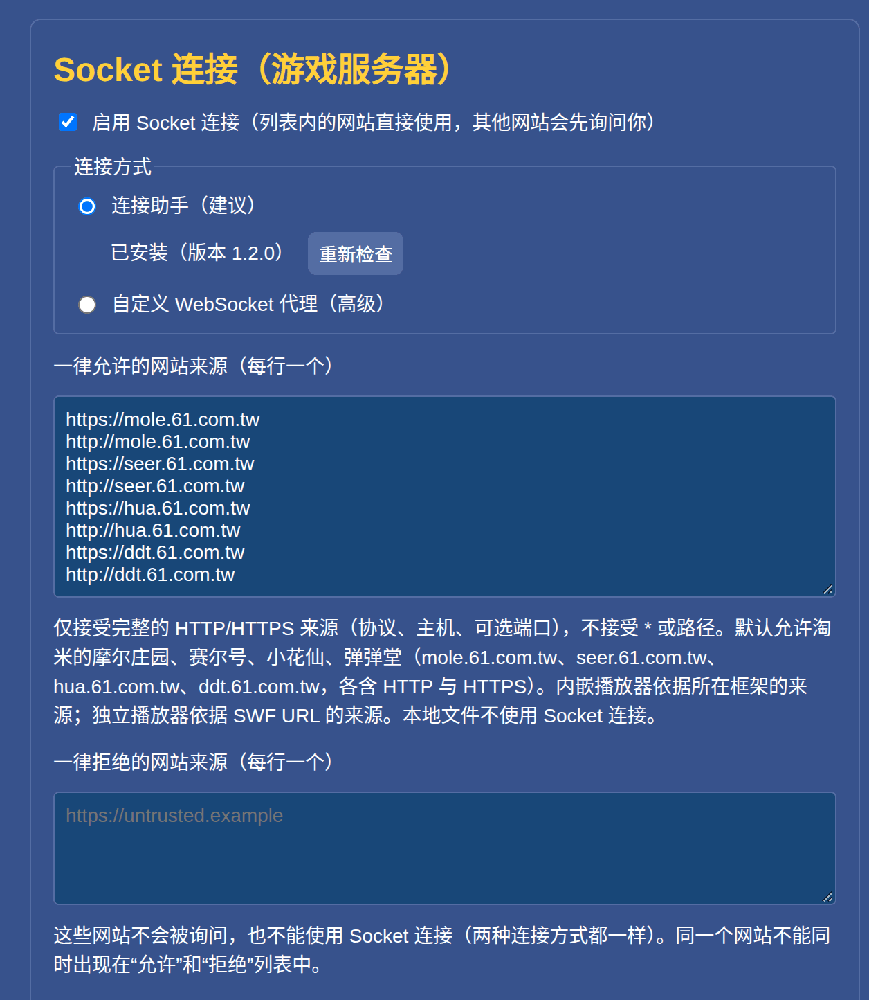
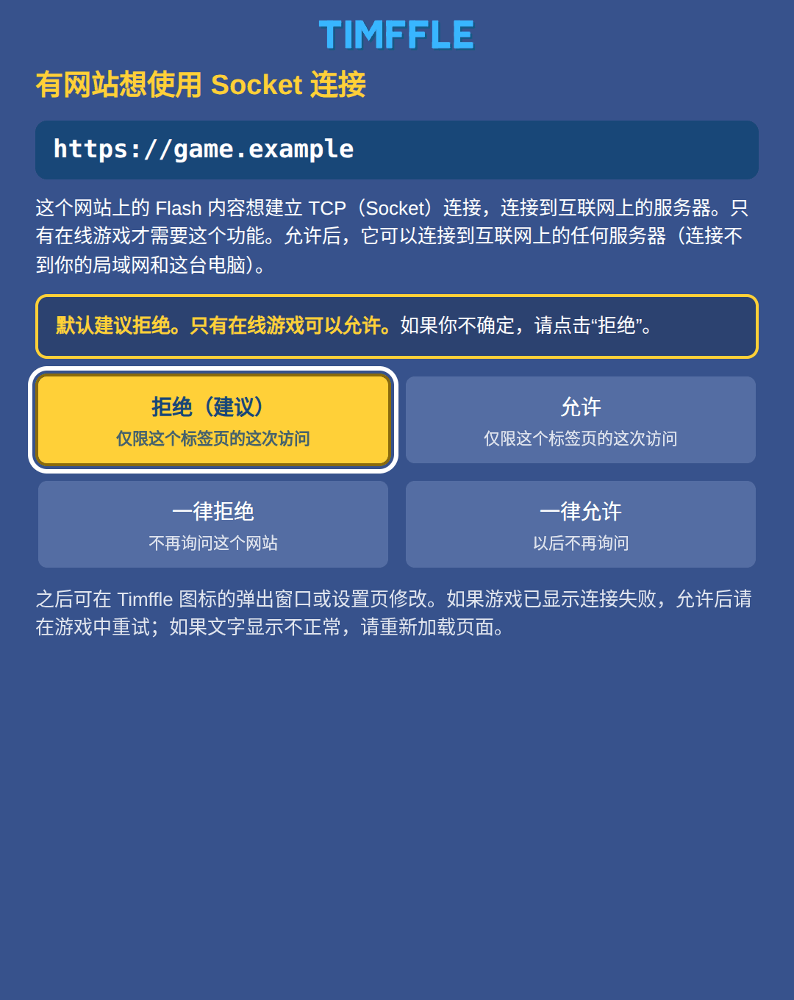
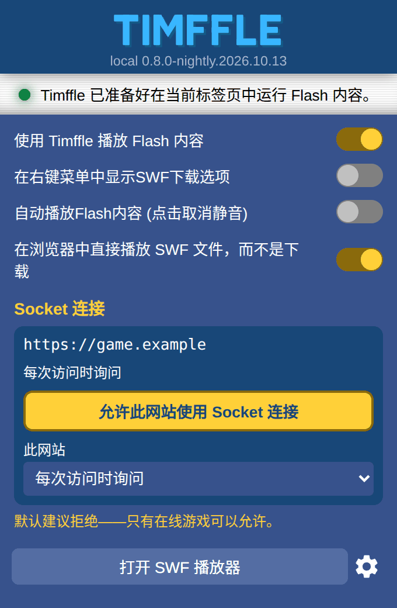
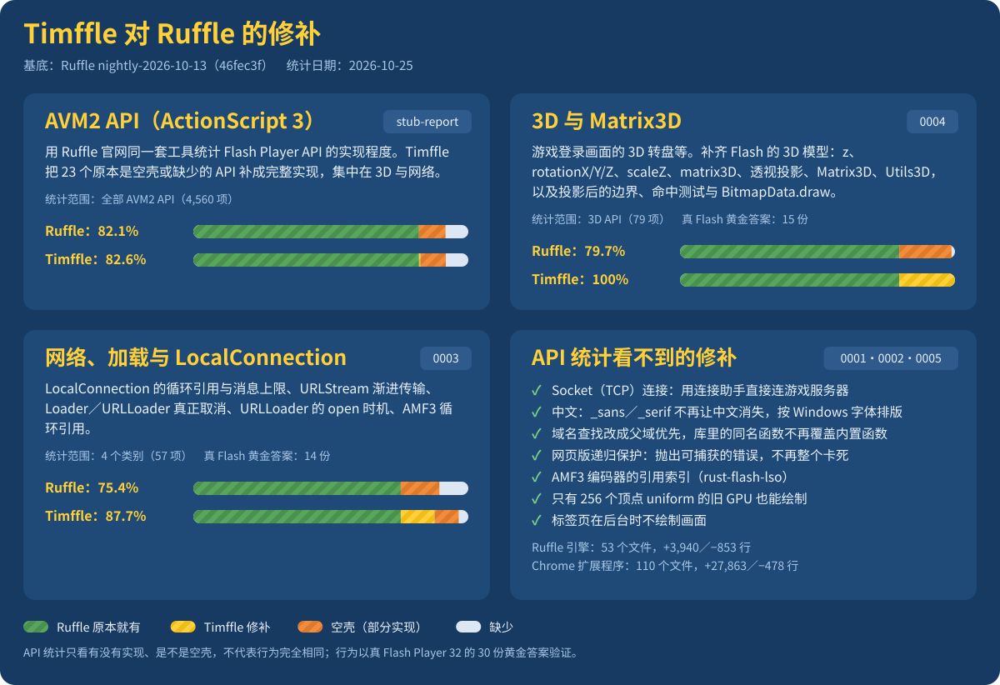

<p align="center">
  
</p>

<h1 align="center">
  
</h1>

<p align="center"><b>让 Flash 在线游戏，在 Chrome 里继续玩。</b></p>

<p align="center">Ruffle，再加上 Flash 在线游戏需要的 TCP Socket 连接。<br>淘米台湾的游戏开箱即用：摩尔庄园 ・ 赛尔号 ・ 小花仙 ・ 弹弹堂</p>

<p align="center">
  <a href="https://github.com/Im-Tim-mI/Timffle/releases/latest"><b>下载最新版</b></a> ・
  <a href="#安装方法">安装方法</a> ・
  <a href="#疑难排解">疑难排解</a>
</p>

<p align="center"><a href="README.md">English</a> ・ <a href="README.zh-TW.md">繁體中文</a> ・ <b>简体中文</b></p>

<p align="center">版本 <code>0.8.0.26308</code>（基于 Ruffle nightly 2026-10-13）｜ 授权 MIT 或 Apache-2.0（任选其一）</p>

> [!IMPORTANT]
> **Timffle 是 [Ruffle](https://ruffle.rs/) 的非官方分支，与 Ruffle 项目、Ruffle LLC、淘米网络（Taomee）没有隶属或合作关系，也没有得到它们的认可。** Flash 模拟内核几乎全部是 Ruffle 与其[数百位贡献者](https://github.com/ruffle-rs/ruffle/graphs/contributors)的成果；本 repo 保留了 Ruffle 完整的 git 历史、作者记录与授权文件。
> **Timffle 的问题请反馈到 [Timffle 的 Issues](https://github.com/Im-Tim-mI/Timffle/issues)，不要反馈给 Ruffle。** 「Ruffle」名称与标志属于 Ruffle 项目，所以本分支使用 Timffle 这个名字与自己的图标（见 [`timffle/docs/BRANDING.md`](timffle/docs/BRANDING.md)）。Ruffle 原本的说明文档保留在 [`README.ruffle.md`](README.ruffle.md)。

---

## 简介

Adobe 已在 2020 年底终止 Flash，浏览器也早已移除它。[Ruffle](https://ruffle.rs/) 用 WebAssembly 模拟 Flash，让它重新能跑；但 Flash **在线游戏**还需要多一样东西：它们会**对游戏服务器开着一条 TCP Socket 连接**（`flash.net.Socket`），而浏览器扩展程序不能开 TCP 连接。单纯的 Ruffle 跑不了这类游戏。

Timffle 是专为这类游戏做的 Ruffle 分支，加上了：

1. **TCP Socket 连接**。一个只需安装一次的连接助手（由 Chrome 按需启动）把游戏的 Socket 转接到游戏服务器，而扩展程序决定**哪些网站可以使用**：你允许的网站，以及第一次要求连接时经你同意的网站。
2. **在线游戏需要的兼容性修正**：用真实的在线游戏找出来，并与 Adobe Flash Player 32 逐行比对——`LocalConnection`、`URLStream`、`Loader`／`URLLoader` 的取消、3D 透视与 `Matrix3D`、AMF3 循环参照…；少了这些，游戏会卡住、点了没反应，或画面位置错误。
3. **看得到的中文**。Ruffle 内置的字体没有中文字；Timffle 用浏览器的字体绘制设备字体的文字，并依游戏指定的 Windows 字体的度量定位。

全部打包成**一个 Chrome 插件包**：下载、安装，打开游戏网址就能登录、玩。

**淘米台湾的游戏**（摩尔庄园、赛尔号、小花仙、弹弹堂）是 Timffle 最初为之打造、也最先测试的对象，所以它们的网站默认就允许使用 Socket 连接，不需要任何设置。它们是现成的范例，不是范围的上限：其他 Flash 在线游戏在要求连接时，可以用同样的方式允许（实际试过哪些，见[支持的游戏与平台](#支持的游戏与平台)）。

> [!NOTE]
> Timffle 只是让浏览器能运行 Flash 内容，不修改游戏的内容、规则或数据，也不包含任何游戏素材。它不是任何游戏或其运营商的官方软件；使用第三方运行环境是否符合游戏的服务条款，请自行确认，风险由用户自负。请只使用自己的账号。

## 特色

- **Flash 在线游戏的 Socket 连接**：游戏照 Flash 的方式打开 `flash.net.Socket`，Timffle 通过连接助手（Windows、macOS、Linux）把它转接到游戏服务器。不用架代理，也不需要另外开任何东西。
- **由你决定哪些网站能用 Socket**：网站必须在你的「一律允许」清单里，或在它第一次尝试时由你回答询问（建议拒绝，只有在线游戏可以允许）。工具栏的弹出窗口可以一键允许或拒绝目前的网站。
- **保守的安全设计**：助手只连公开网络地址（唯一的例外：本身放在局域网 IP 上、你允许过的网站，可以连回它自己那个地址）、不监听任何连接端口、不常驻、不记录连接内容；只有这个扩展程序的 ID 能调用它。
- **以真 Flash 为标准答案**：对 Ruffle 的兼容性修正，都用 Adobe Flash Player 32 的实际输出逐行比对（30 项黄金答案）。
- **看得到中文**：设备字体的文字使用浏览器的字体，并依游戏指定的 Windows 字体（SimSun、Arial Black、Tahoma…）的度量定位。
- **36 种界面语言，和 Ruffle 一样**：页面跟着浏览器的语言（英文与繁体中文由作者撰写，其余 34 种是机器翻译；见[语言](#语言)）。
- **淘米台湾的游戏开箱即用**：默认允许四个游戏网站使用 Socket 连接。
- **一个插件包**：[Releases](https://github.com/Im-Tim-mI/Timffle/releases/latest) 提供 `timffle-chrome-<版本>.zip`，内含 Chrome 插件、连接助手与安装程序。
- **开源，并保留上游历史**：完整保留 Ruffle 的 git 历史、作者记录与授权；Timffle 自己的部分以 MIT 或 Apache-2.0（任选其一）授权，与 Ruffle 相同。

## 快速开始

1. 到 [Releases](https://github.com/Im-Tim-mI/Timffle/releases/latest) 下载最新版的 `timffle-chrome-<版本>.zip`（**Chrome 插件包**），解压缩到一个固定的位置。
2. 安装连接助手，**只要一次**：运行 `helper` 文件夹里的安装程序（Windows `install-windows.cmd`、macOS `install-macos.command`、Linux `sh install-linux.sh`），或在第 3 步之后按插件工具栏弹出窗口的「直接下载安装程序」，它会替你的系统下载对的文件。
3. 打开 `chrome://extensions` → 打开「开发者模式」→「加载已解压的扩展程序」→ 选择 `extension` 文件夹。
4. 打开游戏网站并登录。淘米台湾的游戏，例如 https://mole.61.com.tw/ ，按播放器的播放键，照常登录即可。其他 Flash 在线游戏，打开它的网页：游戏第一次打开 Socket 连接时，Timffle 会询问你（见[第一次连接时的询问](#第一次连接时的询问)），你信任的在线游戏可以允许。

详细步骤与注意事项见[安装方法](#安装方法)。

## 支持的游戏与平台

### 游戏

Timffle 为**一般的 Flash 在线游戏**而做：你允许的网站就能使用 Socket 连接，不管它跑的是哪个游戏。游戏能不能顺利运作，取决于 Ruffle 对它用到的功能支持多少；**淘米台湾的《摩尔庄园》有用真实账号实际玩过**。淘米台湾的四个游戏默认允许 Socket 连接：

| 游戏 | 网址 | 状态 |
|---|---|---|
| 摩尔庄园 | https://mole.61.com.tw/ | **已用真实账号验证**。 |
| 赛尔号 | http://seer.61.com.tw/ | 默认放行 Socket 连接。 |
| 小花仙 | http://hua.61.com.tw/ | 默认放行 Socket 连接。 |
| 弹弹堂 | http://ddt.61.com.tw/main_index.php | 默认放行 Socket 连接。 |

**玩其他 Flash 在线游戏**：打开游戏的网页并开始游戏。它第一次尝试连接时，Timffle 会跳出询问窗口：如果你信任这个游戏，选「允许」（这次访问）或「一律允许」。这时游戏通常已经超时，请在游戏里再连接一次。细节见[第一次连接时的询问](#第一次连接时的询问)。

其他在线游戏如果不能玩，请到 Issues 反馈，附上游戏网址与开发者工具 Console 的输出（见[疑难排解](#疑难排解)）。

### 平台

| 平台 | 验证程度 |
|---|---|
| Linux x64＋Chrome 155 | **实机验证**：安装／移除、自动启停、二进制传输、连接失败处理、摩尔庄园游戏流程 |
| Windows 10／11 x64 | 助手与安装／移除程序在 **Wine 模拟环境**测试（Wine 不是 Windows 实机） |
| Windows 32 位与 ARM64、macOS（Intel／Apple Silicon）、Linux ARM64 | 只做了交叉编译，**未实机测试** |

安装程序替 **Google Chrome** 注册助手（Linux／macOS 上，Beta／Dev／Canary 与 Chromium 只在你用过、用户文件夹已存在时才注册）；Edge、Brave 等其他 Chromium 系浏览器不会被注册。助手尚未取得 Microsoft 或 Apple 的签名／公证。

## 安装方法

### 需求

- **Chrome 桌面版**（Windows 10/11、macOS、Linux；实测 Chrome 155），需要 Manifest V3 扩展程序与 Native Messaging。
- 不需要 Node.js、不需要系统管理员权限、不需要另外开任何服务或窗口。

### 步骤

1. **下载**：到 [Releases](https://github.com/Im-Tim-mI/Timffle/releases/latest) 下载 `timffle-chrome-<版本>.zip`，并核对 SHA-256：

   ```sh
   sha256sum -c timffle-<版本>-SHA256SUMS.txt     # Linux
   shasum -a 256 -c timffle-<版本>-SHA256SUMS.txt # macOS
   ```

   解压缩后会得到 `timffle/`，里面有 `extension/`（Chrome 插件）、`helper/`（连接助手与安装／移除程序）、`LICENSES/`（授权文件）、`NOTICE.md`、`README.txt`。**请把整个文件夹放在固定位置**，之后不要删除或搬移。

2. **安装连接助手（只要一次）**——它让 Chrome 插件能连到游戏服务器：

   | 系统 | 做法 |
   |---|---|
   | Windows 10/11 | 打开 `helper` 文件夹，双击 `install-windows.cmd`。若出现「Windows 已保护你的电脑」，确认是这个文件后按「更多信息」→「仍要运行」。看到「已安裝連線小幫手」（安装程序的输出是繁体中文）即完成。 |
   | macOS | 双击 `helper/install-macos.command`。助手没有 Apple 签名，若被拦下：「系统设置」→「隐私与安全性」→ 找到被拦截的项目按「仍要打开」，再双击一次。 |
   | Linux | 在 `helper` 文件夹开终端：`sh install-linux.sh` |

   安装程序只做「每个用户」的安装：把助手放到用户目录，并向 Chrome 注册 Native Messaging（Windows 写入 `HKCU` 注册表、macOS／Linux 写入用户的 `NativeMessagingHosts` 文件夹）。不装系统服务、不开机自动启动、不会自动解除下载标记或停用任何安全功能。

   **或只下载安装程序**：助手还没装好时，工具栏的弹出窗口（与选项页）有「直接下载安装程序」按钮。它会判断你的系统（Windows 64-bit、Windows ARM64 或 Windows 32-bit；macOS Apple silicon 或 Intel；Linux x64 或 ARM64），在按钮下面写出来（「适用于 Windows 64-bit」），并立刻从 [Timffle-Helper](https://github.com/Im-Tim-mI/Timffle-Helper/releases)（一个只放安装文件的仓库）的 release 开始下载对应的文件。下载完成后运行它：Windows 双击 `.exe`；macOS 打开 zip、双击里面的程序；Linux 运行 `tar xzf timffle-helper-linux-x64.tar.gz && ./timffle-helper-linux-x64`。按钮旁的「其他系统与安装说明」打开列出所有文件的安装页。插件只是请浏览器下载这个文件（不需要额外权限），运行那一下仍由你来按。详见 [`timffle/docs/HELPER-DOWNLOADS.md`](timffle/docs/HELPER-DOWNLOADS.md)。

3. **加载 Chrome 插件**：
   1. 打开 `chrome://extensions`，打开右上角的「**开发者模式**」。
   2. 按「**加载已解压的扩展程序**」，选择解压缩出来的 `extension` 文件夹。
   3. 如果装过官方的 Ruffle 扩展程序，请先停用或移除，避免两个插件抢着接管。

4. **确认助手有装好**：在插件的「选项」页找到「Socket 连接」，「连接助手」旁应显示「已安装（版本 1.4.0）」。若显示找不到：重新运行安装程序，**完全关闭 Chrome 再开**。不必特地去找：助手还没装好的时候，工具栏的弹出窗口会直接说明，并有「直接下载安装程序」按钮，替你的系统下载安装程序（Chrome 扩展程序无法自己运行安装程序，所以运行安装程序那一下仍由你来按）；游戏需要助手却连不到时，Timffle 会立刻跳出「请先安装连接助手」的窗口（一样有下载按钮，每次加载页面只跳一次；窗口里写了你这个系统怎么运行安装程序，并**自己检测安装完成**，一检测到，「继续」按钮就亮起，按下去游戏页面会重新加载、连接重新开始），并在那个标签页的 Timffle 图标出现红色的「!」。按「拒绝」的网站、或本来就不允许的网站不会跳出这个窗口。

5. **开始玩**：打开游戏网站（例如 https://mole.61.com.tw/ ），按播放器的播放键后照常登录，不用设置代理。赛尔号、小花仙、弹弹堂同样直接打开各自的网站；其他网站第一次想用 Socket 连接时会先询问你（[第一次连接时的询问](#第一次连接时的询问)）。首次加载插件后请刷新已打开的游戏页；若仍显示下载 Flash 的提示，等几秒再刷新一次。

### 更新

用新版 ZIP 的 `extension/` 内容覆盖原本加载的文件夹 → 到 `chrome://extensions` 对该插件按「重新加载」→ 游戏页强制刷新（Windows／Linux：`Ctrl+Shift+R`，macOS：`Cmd+Shift+R`）。只有在 [CHANGELOG](timffle/CHANGELOG.md) 写明助手有更新时，才需要重跑安装程序。

### 移除

1. 运行 `helper` 文件夹里的 `uninstall-windows.cmd`、`uninstall-macos.command` 或 `uninstall-linux.sh`（只会删除安装程序自己创建的文件和设置）。
2. 到 `chrome://extensions` 移除插件。

助手的安装位置：Windows `%LOCALAPPDATA%\TimffleSocketHelper`、macOS `~/Library/Application Support/TimffleSocketHelper`、Linux `~/.local/share/timffle-socket-helper`。

## 设置

插件的「选项」页有一个「**Socket 连接（游戏服务器）**」区块（图中是英文版浏览器；文字跟着浏览器的语言，见[语言](#语言)）：

<p align="center"></p>

- **助手的状态**（「连接助手」下方）：显示「已安装（版本 …）」，或没装好的原因。助手不在，或与这个插件不相符时，旁边会出现「直接下载安装程序」按钮，替你的系统下载安装程序（和弹出窗口的提示是同一颗按钮），「其他系统与安装说明」则打开列出所有安装文件的安装页。
- **连接方式**：默认且建议「连接助手」；高级用户可改成「自定义 WebSocket 代理」，自己运行 [`timffle/relay/`](timffle/relay/) 里的本机 WebSocket↔TCP 代理（需要 Node.js 22+，Chrome 可能询问本机网络访问权限）。
- **一律允许的网站来源（每行一个）**：清单内的网站来源（协议＋主机＋可选端口，不接受 `*` 或路径）可以直接使用 Socket 连接，不会询问。默认是淘米台湾四个游戏网站（摩尔庄园、赛尔号、小花仙、弹弹堂）的 `mole／seer／hua／ddt.61.com.tw`，各含 `http://` 与 `https://`。要加其他网站**不必自己输入**：用下面的「第一次连接时的询问」或「在弹出窗口直接设置」。**只允许你信任的在线游戏**，因为被允许的网站可以通过助手连到任何公开网络上的 TCP 地址（本身放在局域网 IP 上的网站，另外还能连到它自己那台电脑的任何连接端口）。
- **一律拒绝的网站来源（每行一个）**：这些网站不会被询问，也不能使用 Socket 连接（两种连接方式都一样）。同一个网站不能同时在「允许」与「拒绝」清单里（保存时会提醒；若真的同时存在，拒绝优先）。
- **两种连接方式各有自己的「一律允许」清单**：切到「自定义 WebSocket 代理」时，文本框会换成代理自己的清单，只有那份清单里的网站拿得到代理网址与 token。所以在连接助手模式按过「允许」的网站，不会因为你之后改用自定义代理就拿到 token。
- **设置页开着的时候**，若你在弹出窗口改了设置（例如把某网站设成「一律拒绝」），没有编辑过的表单会自动更新；有编辑过的表单在保存时会被拦下并显示最新设置，不会把那边的决定改回去。
- 保存或停用后，请重新加载游戏页。

### 第一次连接时的询问

连接方式是「连接助手」时，**不在上面两个清单的网站**第一次尝试使用 Socket 连接，Timffle 会跳出**插件自己的窗口**询问你。它是独立窗口，不是网页里的东西，所以网页不能遮住它、也不能替你按：

<p align="center"></p>

| 按钮 | 效果 |
|---|---|
| **拒绝（建议）** | 这个标签页这次访问拒绝。关闭标签页、或这个标签页换到别的网站后，下次再问 |
| **允许** | 这个标签页这次访问允许。同上，下次再问（刷新同一页不算新的访问） |
| **一律拒绝** | 存入「一律拒绝」清单，不再询问 |
| **一律允许** | 存入「一律允许」清单，不再询问 |

- **默认建议拒绝，只有在线游戏可以允许。** 窗口会明确警告，并把「拒绝」放在最显眼、默认选取的位置。
- 网站本身放在局域网 IP 上时（例如 `http://192.168.0.163/`），窗口的说明会改成：允许后它可以连到那个地址（网站所在的那台电脑）与互联网上的任何服务器，局域网上的其他设备仍然连不到。
- 直接关闭窗口等于「拒绝」（这次访问）。为了避免你正在游戏里点击或打字时误按：窗口出现或获得焦点后的 0.7 秒内，所有输入都被忽略；「允许」**只接受鼠标（或触摸）点击，键盘永远不能允许**（Tab、Enter、Space 是游戏登录常打的键），而且鼠标要在那 0.7 秒之后移到按钮上才算；「拒绝」任何输入都可以。需要用键盘允许时，请用工具栏弹出窗口里的按钮。
- 同一个网站同时要求多条连接只会问一次；一次只会有一个窗口；同一个标签页每次访问最多跳出 3 次窗口、整个扩展程序每分钟最多 6 次，超过的网站直接拒绝。等你回答的连接不占用连接名额，所以没人理的问题不会影响已允许的游戏。
- 你回答之前，游戏通常已经等到超时并显示连接失败：**允许后请在游戏里再试一次**；若文字显示不正常，请重新加载页面。
- 内嵌在别的网站页面里的游戏（`iframe`）以**它自己的来源**询问，窗口会同时显示外面那个页面的来源。
- 只有「连接助手」模式会询问。「自定义 WebSocket 代理」模式不会询问，没列出的网站一律不能使用（代理网址含 token，不会给没被允许的网站）。
- 没有 Flash 内容的网页不受影响，Timffle 也不会替它们改动浏览器的 `WebSocket`（例外：网页含有同源的 `iframe` 时，Ruffle 自己的框架检测会读设置而提早安装转接，行为仍与原生 `WebSocket` 相同）。
- 扩展程序自己的页面（弹出窗口、设置页、欢迎页、安装页、询问窗口）网页**无法嵌入框架**，所以网页不能伪造它们或盖住它们。

### 在弹出窗口直接设置

点浏览器工具栏上的 Timffle 图标，弹出窗口的「Socket 连接」区块会显示**目前标签页的网站**：

<p align="center"></p>

- **允许此网站使用 Socket 连接**：一键把这个网站加入「一律允许」清单，不用输入网址。按下后已打开的标签页要重新加载才会套用（弹出窗口的「重新加载」按钮会亮起）。
- 下拉列表可改成「**每次访问时询问**」（从两个清单移除，下次再问）、「**一律允许**」或「**一律拒绝**」。要取消一律允许或一律拒绝，就改回「每次访问时询问」。
- 这个标签页里**其他网站的框架**如果已经被询问过，也会列在下面，各有自己的按钮与菜单。
- 状态栏也会显示这个标签页「本次访问」的允许或拒绝。
- 同一页的其他选项是 Ruffle 原有的播放设置（设备字体、模拟的 Flash 版本、ActionScript 运行时间上限等）。「**Device font renderer**」默认是 Canvas（用浏览器的字体），中文才显示得出来；在那里选 Embedded 可以改回 Ruffle 内置的字体。

## 语言

Timffle 的页面（设置页、弹出窗口、安装页、询问窗口）会跟着浏览器的界面语言。支持的语言和 Ruffle 扩展程序相同，共 36 种：阿拉伯文、波斯尼亚文、加泰罗尼亚文、简体中文与繁体中文、克罗地亚文、捷克文、荷兰文、英文、世界语、芬兰文、法文、加利西亚文、德文、希伯来文、匈牙利文、印尼文、意大利文、日文、韩文、书面挪威语、波兰文、葡萄牙文（巴西与葡萄牙）、罗马尼亚文、俄文、塞尔维亚文、斯洛伐克文、斯洛文尼亚文、西班牙文、瑞典文、鞑靼文、泰文、土耳其文、乌克兰文与越南文。阿拉伯文与希伯来文由右至左排版。

- **谁翻译的**：Timffle 添加的文字（Socket 设置、弹出窗口的区块与提示、安装页、询问窗口）放在 [`timffle/locales/`](timffle/locales/)，每种语言一个文件。英文与繁体中文由作者撰写；**其余 34 种语言是机器翻译**（简体中文由繁体文字转换而来），没有请母语人士审阅，措辞可能不自然，鞑靼文尤其如此。欢迎到 [Timffle 的 issues](https://github.com/Im-Tim-mI/Timffle/issues) 指正。
- **Ruffle 原有的文字**（一般选项与播放器消息）来自 Ruffle 的翻译，完整程度和 Ruffle 一样：有些语言（例如世界语、加利西亚文、挪威文、泰文）在 Ruffle 的翻译者补完之前，这些地方仍显示英文。
- **Chrome 没有**波斯尼亚文、世界语、加利西亚文与鞑靼文的**界面语言**，所以 Chrome 上这四种会显示英文；翻译仍然附上，和 Ruffle 一样。
- **没有翻译的部分**：连接助手安装程序的消息（繁体中文与英文）、本 README（英文、繁体中文、简体中文）。

## 疑难排解

| 症状 | 可能原因／处理 |
|---|---|
| 弹出窗口说还没安装助手，或选项页显示找不到助手 | 按「直接下载安装程序」并运行下载的文件（或运行 `helper` 里的安装程序），然后**完全关闭 Chrome**（含后台进程）再开。Chrome 只在启动时读取 Native Messaging 注册。 |
| 打开游戏仍显示「下载 Flash」 | 确认插件已启用且没有官方 Ruffle 扩展程序同时启用；刷新，等几秒再刷新一次。 |
| 游戏连不上 | 确认该网站已被允许（工具栏的弹出窗口会显示目前的状态）；如果在你回答询问之前游戏已经超时，请在游戏里再试一次。改了设置后请刷新页面。 |
| 局域网架设：游戏服务器架在自己的局域网上（例如 `192.168.0.163`），其他电脑连不上 | 三件事都要做到：**每一台**要玩的电脑上的助手都要是 1.4.0 以上（在那台电脑重新运行安装程序，只更新插件不够；选项页会显示「已安装（版本 1.4.0）」，助手太旧时游戏一连接就会跳出「请先安装连接助手」的窗口）；网页要**用 IP 地址打开**（`http://192.168.0.163/`，不能用电脑名称或网域名称）；游戏要连的也必须是**同一个 IP**。只有那一个地址会被放行：服务器的其他部分若在局域网上的另一台电脑，或游戏连 `localhost`／`127.0.0.1`，仍然连不到。网站也要先被允许（询问窗口或「一律允许」清单）。 |
| 第一次点击（播放键或游戏里的「开始」）没反应 | 再点一次。自动化测试中观察到第一次点击偶尔不起作用，原因没有查明。 |
| 画面上的中文变成方框或消失 | Linux 缺少中日韩字体：安装 `fonts-noto-cjk` 之类的字体包后重开 Chrome。Timffle 默认使用浏览器的字体绘制设备字体的文字。 |
| Windows／macOS 拦下安装程序或助手 | 未签名的预期行为，请确认文件来源后按提示运行；不要为此停用系统的安全保护。 |
| 登录后控制台出现 `Error #2030`（来自淘米游戏的登录礼包模块） | 已知：游戏自己的竞态条件；重现实验中真 Flash 32 也丢同一个错误。 |
| 想反馈问题 | 到 [Timffle Issues](https://github.com/Im-Tim-mI/Timffle/issues)，附上游戏网址、Chrome 版本、操作系统与开发者工具 Console 的输出（先隐去账号、密码与 token）。**请不要把 Timffle 的问题反馈给 Ruffle。** 怀疑是安全问题时，请不要公开贴出细节，先开一个只说明「有安全问题想私下反馈」的 Issue。 |

## 运作原理与安全设计

```
游戏页面  （例如 https://mole.61.com.tw/）
   │   Timffle（WebAssembly，Ruffle 内核＋修正）接管 Flash 组件；游戏调用 flash.net.Socket
   ▼
Chrome 扩展程序（Manifest V3）
   │   page bridge → content script → service worker
   │   只放行「允许的网站来源」，其他网站先询问用户；每个 Socket 对应一条 Native Messaging 连接
   ▼
连接助手 timffle-socket-helper（Go；由 Chrome 按需启动，用完退出）
   │   只连公开网络地址：拒绝私网、本机、链接本地、多播与保留地址（含 IPv4 映射 IPv6）
   │   唯一例外：本身放在局域网 IP 上的网站，可以连回它自己那个地址
   ▼
游戏服务器（TCP）
```

- **Chrome 不允许扩展程序开 TCP**，所以需要原生程序；Native Messaging 是 Chrome 官方支持的做法。助手**不监听任何连接端口、不装服务、不常驻**，每个 Socket 一个进程，连接结束就退出。
- **只有一个扩展程序 ID 能调用助手**：`eandddnbchclalbjkhfelhjhpijifcog`（由 [`timffle/extension-key/`](timffle/extension-key/) 的公钥决定）。
- **局域网上的网站只能连回自己**：网站本身放在局域网 IP 上（`10.x.x.x`、`172.16.x.x`～`172.31.x.x`、`192.168.x.x`，或 IPv6 的 `fc00::/7`）而且你允许了它，它还可以连到**那一个地址**的任何连接端口。这个地址由扩展程序从浏览器提供的网站来源算出、助手再验证一次，网页自己不能指定；用名称打开的网站没有这个例外（所以 DNS rebinding 用不上）；`localhost`／`127.0.0.1`、链接本地地址与局域网上的其他设备仍然挡。要注意：你允许的局域网网站可以连那台机器的任何连接端口；网站就在这台电脑上时，那台机器就是这台电脑。
- 助手**不记录连接内容**，有流量控制与上限（单次送出 ≤ 64 KiB、单次接收 ≤ 32 KiB、缓冲 ≤ 1 MiB、停滞 30 秒超时、全局最多 16 个 Socket）。
- 安装与移除只动安装程序自己创建的文件；遇到内容已变更的原生组件、外来的同名文件，或受操作目录中的符号链接时，会拒绝处理、不会覆盖。

完整说明：[`timffle/docs/ARCHITECTURE.md`](timffle/docs/ARCHITECTURE.md)、[`timffle/docs/PROTOCOL.md`](timffle/docs/PROTOCOL.md)。

## 已知限制

- **其他 Flash 在线游戏**：你允许的网站都能使用 Socket 连接，但游戏能不能运作取决于 Ruffle 对它所用功能的支持；只有摩尔庄园用真实账号玩过，淘米台湾的另外三个游戏只是默认放行 Socket 连接。
- **没有 Socket 策略文件（policy file）**：真正的 Flash 在每次 Socket 连接前，都会向目的地服务器索取 Socket 策略文件。Timffle（和 Ruffle 一样）不会，所以**游戏服务器没有否决权**：「一律允许」清单与你对第一次询问的回答，是唯一的把关。这就是为什么只该允许你信任的在线游戏。
- **ActionScript 2 的 `XMLSocket`** 与 `flash.net.Socket` 走同一条 Socket 路径，但只测试过 `flash.net.Socket`。
- **平台**：Windows 只在 Wine 测过、macOS 未实测；助手**未签名**。询问窗口、弹出窗口（含助手的提示）与安装页只在 Chrome 155 桌面版（无头模式）验证过；没有在有画面的 Chrome、Windows、macOS、Firefox 与 Safari 上试过。
- **品牌**：只有网页版（扩展程序、网页 Demo、播放器画面）改成 Timffle；桌面版、Safari 扩展程序、npm 包的文字与标识符仍是上游 Ruffle 的，**不要以 Timffle 名义分发它们的构建**（见 [`timffle/docs/BRANDING.md`](timffle/docs/BRANDING.md)）。
- **3D**：嵌套的「投影拥有者」与 Flash 不同；Flash 对 3D 图做约 1 像素的双线性滤波，Timffle 边缘较利落；透视只在 wgpu 渲染器实现。`Matrix3D.determinant`／`invert` 与 Flash 差在最后一位有效数字。
- **命中测试**：Flash 的 `hitTestPoint(x, y, true)` 以整数像素判断，Timffle 用精确坐标；边缘偶有 1～2 格差异。
- **网页版递归深度**：WebAssembly 调用堆栈比 Flash 浅，保护上限 900 层；赛车地图少数远距离寻路会被截断。
- **文字位置**：Flash 用游戏指定的 Windows 字体排版。对常见的字体（SimSun、Arial Black、Tahoma…），即使浏览器必须用别的字体顶替，Timffle 也采用 Windows 的行度量，所以文字与 Flash 相差约一两个像素以内；其他字体使用浏览器自己的度量，可能偏得更多。
- **语言**：除了英文与繁体中文，Timffle 添加的文字都是机器翻译，没有请母语人士审阅；连接助手安装程序的消息只有繁体中文与英文；Ruffle 原有的文字与 Ruffle 的翻译一样完整。
- 其他已知差异：[`timffle/docs/CHANGES-FROM-RUFFLE.md`](timffle/docs/CHANGES-FROM-RUFFLE.md) 末尾与 [`timffle/docs/FLASH-NOTES.md`](timffle/docs/FLASH-NOTES.md)。

## 与 Ruffle 的关系

Timffle 以 Ruffle `nightly-2026-10-13`（commit [`46fec3f`](https://github.com/ruffle-rs/ruffle/commit/46fec3f1b2e625fae7035bb3b00d6d5c0ec0d413)）为基底，之后的每一项改动都是独立的 commit：

| Commit 标题 | 内容 |
|---|---|
| `extension: Native socket helper bridge and socket settings` | Chrome 扩展程序的 Socket 桥接、与助手通信、「Socket 连接」设置页、淘米台湾四站的默认允许清单、单元测试 |
| `web: WebSocket socket backend fixes and canvas generic fonts` | 网页版 Socket 后端、canvas 设备字体的通用名称（`_sans` 等）修正（否则中文会消失） |
| `avm2: Network, LocalConnection, URLStream and loader fixes` | `LocalConnection`、`URLStream`、`Loader`／`URLLoader` 取消、AMF3 循环参照、网域名称「先父网域」解析、网页版递归深度保护 |
| `render: 3D transforms, Matrix3D semantics and perspective projection` | `z`／`rotationX/Y/Z`／`scaleZ`／`matrix3D`、`perspectiveProjection`、`Matrix3D`、`Utils3D`、投影后的 `getBounds`／命中测试／`BitmapData.draw` |
| `vendor: Add rust-flash-lso …` ＋ `flash-lso: Fix AMF3 encoder reference indices` | 以 subtree 收录 [rust-flash-lso](https://github.com/ruffle-rs/rust-flash-lso)（含其完整历史）并修正 AMF3 编码器 |
| `web: Rebrand the web extension and player UI as Timffle` | 用户看得到的名称、图标与链接改成 Timffle（见 [`timffle/docs/BRANDING.md`](timffle/docs/BRANDING.md)） |

之后的 commit 加上了第一次连接时的询问、弹出窗口与设置清单、canvas 文字的 Windows 字体度量，以及各个发行版（见 [`timffle/CHANGELOG.md`](timffle/CHANGELOG.md)）。每项修正的细节与原因：[`timffle/docs/CHANGES-FROM-RUFFLE.md`](timffle/docs/CHANGES-FROM-RUFFLE.md)。所有被修改过的 Ruffle 文件清单（Apache-2.0 第 4(b) 条的「修改声明」）：[`timffle/MODIFIED-FILES.md`](timffle/MODIFIED-FILES.md)。要看完整差异：`git diff 46fec3f -- . ':!timffle'`。

### Timffle 对 Ruffle 的修补

<p align="center"></p>

- **怎么算的**：用 Ruffle 官网同一套统计工具（[`tools/stub-report`](tools/stub-report) 加 [`ruffle-rs/api-report`](https://github.com/ruffle-rs/api-report)），各跑一次 Ruffle `46fec3f` 与 Timffle（2026-10-25 的 `9096355ce`）。每个 Flash Player API 算一项，空壳（stub）画成橘色、不算实现，算法和 Ruffle 官网相同。**这只看 API 有没有实现，不代表行为完全相同**；行为以真 Flash Player 32 的实测为准，见 [`timffle/difftest/expected/`](timffle/difftest/expected/) 的 30 份黄金答案（3D 15 份、网络与 LocalConnection 14 份、基本 1 份）。
- **补齐的 23 个 API**：`DisplayObject` 的 `z`、`rotationX`／`rotationY`／`rotationZ`、`scaleZ`、`globalToLocal3D()`、`local3DToGlobal()`；`Transform` 的 `matrix3D`、`perspectiveProjection`、`getRelativeMatrix3D()`；`PerspectiveProjection` 的 `fieldOfView`、`focalLength`、`projectionCenter`；`Matrix3D` 的 `pointAt()`、`recompose()`；`Utils3D.pointTowards()`；`URLStream` 的 `stop()`、`position`、`length`、`objectEncoding`；`LocalConnection.isPerUser`；`Loader.close()`、`URLLoader.close()`。
- **3D API** 指 `Vector3D`、`Matrix3D`、`Utils3D`、`PerspectiveProjection`，加上 `DisplayObject` 与 `Transform` 的 3D 成员（共 79 项）；**网络与 LocalConnection** 指 `URLStream`、`URLLoader`、`LocalConnection`、`Loader` 四个类别（共 57 项）。图与数字由 [`timffle/scripts/ruffle_patches.py`](timffle/scripts/ruffle_patches.py) 产生，数字存在 [`timffle/docs/data/ruffle-patches.json`](timffle/docs/data/ruffle-patches.json)。

## 罗技优惠码

<p align="center"><a href="https://store.logitech.tw/discount/LOGITIM"></a></p>

**折扣码 `LOGITIM`：[罗技台湾官方在线商城](https://store.logitech.tw/discount/LOGITIM)电竞类别九折**，可使用到 2026/12/31。点这个链接会自动带入折扣码，也可以在结账页面输入。

**此为罗技官方在线商城的九折优惠码。本项目与罗技毫无关系：**Timffle 与罗技没有隶属、背书或赞助关系。「Logitech」「Logi」与横幅图中的产品名称、照片属于罗技，图中的价格是制作当天的价格。同样的区块也在扩展程序的设置页与弹出窗口里（弹出窗口默认展开，点标题可以折叠）。只有你点击时才会在浏览器打开链接，不会从网络加载任何东西。这是台湾商店的优惠码，所以只有浏览器的界面语言是中文或英文时才会显示，其他语言看不到。

## 开发

### 从源代码构建

需要：git、Rust 1.99（含 `wasm32-unknown-unknown`）、wasm-bindgen CLI 0.2.127（要与 `Cargo.lock` 一致）、binaryen（`wasm-opt`）、Node.js 24＋npm、Go 1.27、Python 3。本 repo 已包含所有源代码（含修补过的 flash-lso），**不需要另外下载 Ruffle**：

```sh
git clone https://github.com/Im-Tim-mI/Timffle.git && cd Timffle
VERSION4=0.8.0.26308 timffle/scripts/build-extension.sh   # 构建 wasm 与 Chrome 扩展程序 → web/packages/extension/dist/ruffle_extension.zip
VERSION4=0.8.0.26308 timffle/scripts/package-release.sh   # 交叉编译助手（7 个平台）并打包发行 ZIP（含授权文件）→ timffle/build/out/
```

构建脚本默认会把构建机的家目录与用户名从 wasm 里改写掉，打包脚本打包前后都会检查，发现就拒绝产出发行 ZIP。步骤、工具版本、扩展程序密钥与常见问题：[`timffle/docs/BUILD.md`](timffle/docs/BUILD.md)。Ruffle 原有的桌面版等其他部分，构建方式与上游相同（见 [`README.ruffle.md`](README.ruffle.md)），但请先读 [`timffle/docs/BRANDING.md`](timffle/docs/BRANDING.md)。

### 测试

| 测试 | 内容 | 位置 |
|---|---|---|
| 差异测试（对真 Flash） | 用 Haxe 写小 SWF，在 Adobe Flash Player 32（Wine）与 Timffle 各跑一次，逐行比对；30 项黄金答案。 | [`timffle/difftest/`](timffle/difftest/) |
| 助手单元测试 | Go：协议、连接策略、流量控制、安装／移除 | `timffle/helper/*_test.go` |
| 打包测试 | 发行 ZIP 的内容、权限与私钥检查 | `timffle/helper/installer-tests/` |
| 扩展程序单元测试 | 设置、页面桥接、后台权限、第一次连接的询问、36 种语言的文字目录 | `web/packages/extension/tests/` |
| 品牌检查 | 用户看得到的文字不得再出现「Ruffle」产品名 | `python3 timffle/scripts/rebrand.py --check` |
| 语言检查 | 每一句界面文字在 36 种语言都有（只有折扣码区块例外，只有英文与中文），占位符与技术用词没有被翻掉 | `python3 timffle/scripts/sync_locales.py --check` |
| 浏览器＋助手集成测试 | 无头 Chrome＋真助手，只连 localhost；并逐一用每种界面语言开真 Chrome 检查 | [`timffle/tools/native-regress/`](timffle/tools/native-regress/) |
| Ruffle 自身回归测试 | 上游测试套件加上我们添加的测试 | `cargo test -p tests --test tests` |

方法与重现步骤：[`timffle/docs/TESTING.md`](timffle/docs/TESTING.md)。每个版本实际跑过哪些测试、结果如何，记在 [`timffle/CHANGELOG.md`](timffle/CHANGELOG.md)。

### Repo 结构

本 repo 就是 Ruffle 的完整源代码树（`core/`、`web/`、`desktop/`、`render/`、`swf/`… 与上游相同的位置），再加上：

```
README.md / README.zh-TW.md / README.zh-CN.md   Timffle 的说明：英文（默认）、繁體中文、简体中文
README.ruffle.md           Ruffle 原本的 README（原样保留）
LICENSE.md                 Ruffle 的授权文件（原样保留；含第三方依赖的授权清单）
NOTICE.md                  Timffle 的声明、著作权、第三方组件与商标说明
vendor/rust-flash-lso/     rust-flash-lso（git subtree，含历史；MIT，见其 LICENSE）
timffle/                   Timffle 自己的部分：
  LICENSE-MIT / LICENSE-APACHE   Timffle 原创部分的授权
  CHANGELOG.md                   版本历史
  MODIFIED-FILES.md              修改过的 Ruffle 文件清单（脚本生成）
  docs/                          架构、通信协议、构建、测试、品牌、跟进上游、对 Ruffle 的修正、Flash 行为记录
  helper/                        连接助手（Go）、安装／移除程序、打包脚本
  relay/                         高级：本机 WebSocket↔TCP 代理（内含 MIT 授权的 ws 库）
  extension-key/                 扩展程序公钥与 ID（私钥不在 repo 内）
  locales/                       Timffle 自己的界面文字，每种语言一个文件（由 scripts/sync_locales.py 复制到扩展程序的消息目录）
  difftest/                      差异测试：Haxe 测试、真 Flash 的黄金答案、运行／比对脚本
  tools/                         Chrome 冒烟测试、集成测试、真实账号测试、截屏工具
  branding/                      Timffle 图标与标志的生成程序
  scripts/                       构建、打包、路径检查、品牌替换与检查、界面文字同步、修改清单
```

### 跟进上游 Ruffle

Timffle 会持续跟进 Ruffle。做法（细节见 [`timffle/docs/UPSTREAM.md`](timffle/docs/UPSTREAM.md)）：

```sh
git remote add upstream https://github.com/ruffle-rs/ruffle.git   # 只需一次
git fetch upstream tag nightly-YYYY-MM-DD --no-tags
git merge nightly-YYYY-MM-DD           # 用 merge 保留双方历史，不要 rebase 已公开的分支
python3 timffle/scripts/rebrand.py     # 上游添加或翻译的文字重新换成 Timffle
python3 timffle/scripts/rebrand.py --check
python3 timffle/scripts/sync_locales.py   # Timffle 自己的界面文字放回（被上游版本取代的）消息目录
python3 timffle/scripts/sync_locales.py --check
timffle/scripts/list-modified-files.sh > timffle/MODIFIED-FILES.md
```

### 贡献

欢迎在 [Issues](https://github.com/Im-Tim-mI/Timffle/issues) 反馈问题或提出建议，也欢迎送 Pull Request。请先读 [`CONTRIBUTING.md`](CONTRIBUTING.md)（上游 Ruffle 的贡献指南，原样保留）与 [`timffle/docs/UPSTREAM.md`](timffle/docs/UPSTREAM.md) 的「贡献规则」。Flash 行为的修正请附能在真 Flash Player 上生成标准答案的差异测试，或 Ruffle 风格的 SWF 回归测试。

## 授权、致谢与声明

- **Ruffle**：Copyright (c) 2018-2022 Ruffle LLC 与 Ruffle 贡献者，MIT 或 Apache-2.0 双授权，授权全文与第三方依赖清单在 [`LICENSE.md`](LICENSE.md)（原样保留）。Ruffle 的贡献者记录完整保留在本 repo 的 git 历史中（`git shortlog -sn 46fec3f`）。
- **rust-flash-lso**：Copyright (c) 2020 Callum Thomson，MIT，见 [`vendor/rust-flash-lso/LICENSE`](vendor/rust-flash-lso/LICENSE)。
- **Timffle 的修改与原创部分**：Copyright (c) 2026 Im-Tim-mI 与 Timffle 贡献者，**MIT 或 Apache-2.0，任选其一**：[`timffle/LICENSE-MIT`](timffle/LICENSE-MIT)、[`timffle/LICENSE-APACHE`](timffle/LICENSE-APACHE)。Timffle 的图标与标志是原创作品，同样适用上述授权。
- 除非你明确另外声明，你有意提交到本项目的任何贡献，依 Apache-2.0 对「贡献」的定义，都以上述双授权提供，不附加任何额外条款。
- **商标**：「Ruffle」名称与标志属于 Ruffle 项目；Timffle 只以描述方式提及（例如「Ruffle 的分支」「基于 Ruffle」）。「摩尔庄园」「赛尔号」「小花仙」「弹弹堂」「淘米」「Flash」「Adobe」「Chrome」等属于各自的权利人。
- **本 repo 不包含任何游戏素材**（游戏的 SWF、DLL、图片、游戏代码、服务器地址、数据包格式与加解密），也不修改游戏文件。请遵守游戏的服务条款，只用自己的账号。完整声明见 [`NOTICE.md`](NOTICE.md)。行为的来源与验证方式记在 [`timffle/docs/PROVENANCE.md`](timffle/docs/PROVENANCE.md)。
