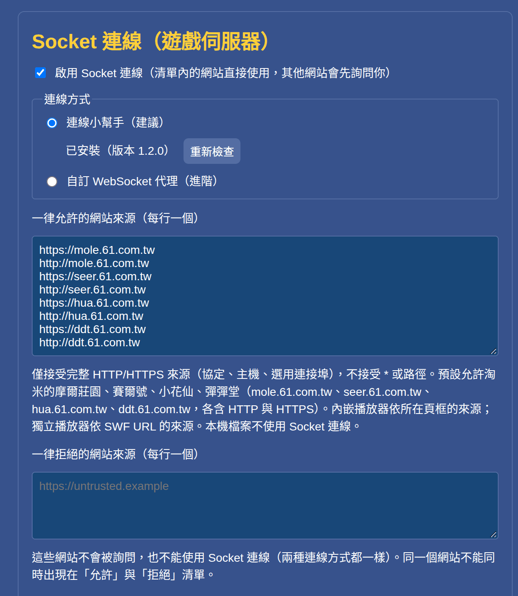
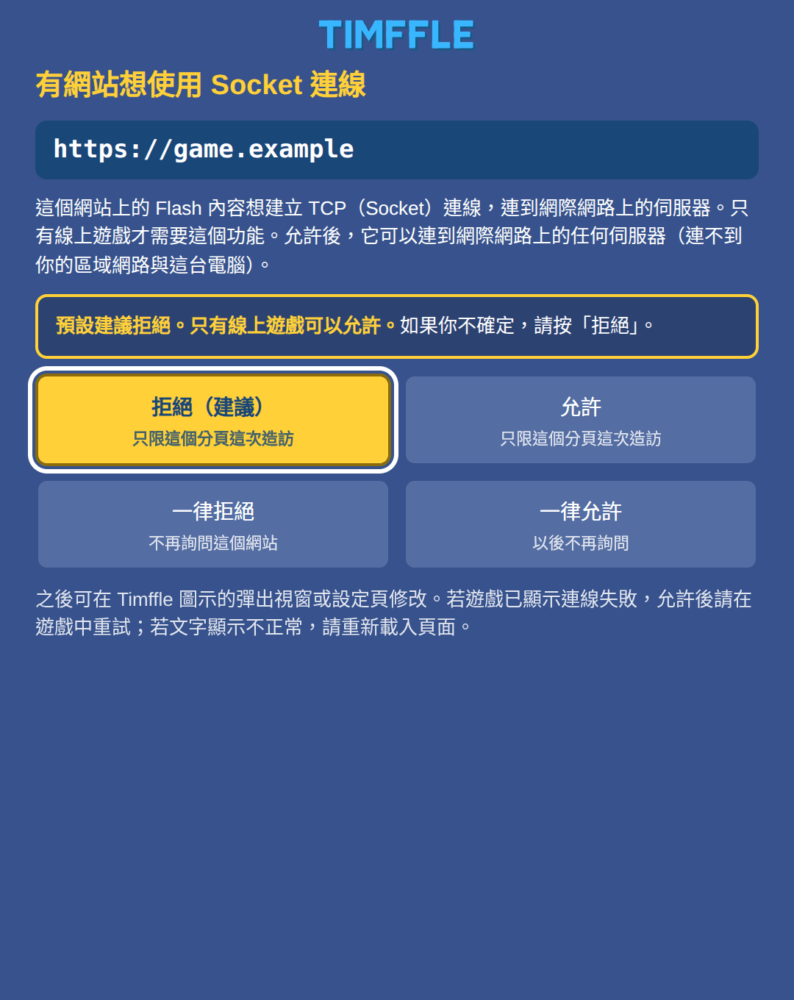
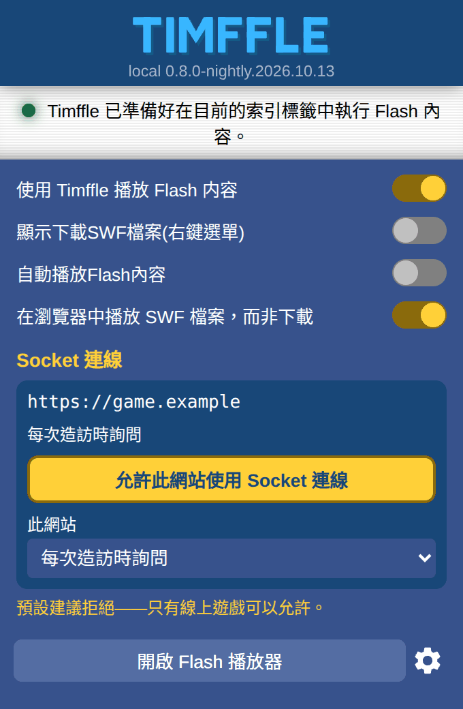
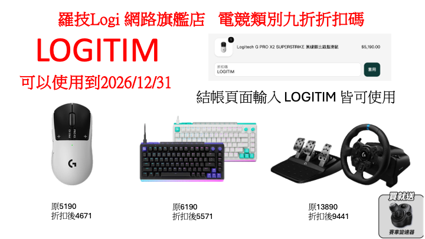

<p align="center">
  
</p>

<h1 align="center">
  
</h1>

<p align="center"><b>讓 Flash 線上遊戲，在 Chrome 裡繼續玩。</b></p>

<p align="center">Ruffle，再加上 Flash 線上遊戲需要的 TCP Socket 連線。<br>淘米台灣的遊戲開箱即用：摩爾莊園 ・ 賽爾號 ・ 小花仙 ・ 彈彈堂</p>

<p align="center">
  <a href="https://github.com/Im-Tim-mI/Timffle/releases/latest"><b>下載最新版</b></a> ・
  <a href="#安裝方法">安裝方法</a> ・
  <a href="#疑難排解">疑難排解</a>
</p>

<p align="center"><a href="README.md">English</a> ・ <b>繁體中文</b> ・ <a href="README.zh-CN.md">简体中文</a></p>

<p align="center">版本 <code>0.8.0.26304</code>（基於 Ruffle nightly 2026-10-13）｜ 授權 MIT 或 Apache-2.0（任選其一）</p>

> [!IMPORTANT]
> **Timffle 是 [Ruffle](https://ruffle.rs/) 的非官方分支，與 Ruffle 專案、Ruffle LLC、淘米網絡（Taomee）沒有隸屬或合作關係，也沒有得到它們的認可。** Flash 模擬核心幾乎全部是 Ruffle 與其[數百位貢獻者](https://github.com/ruffle-rs/ruffle/graphs/contributors)的成果；本 repo 保留了 Ruffle 完整的 git 歷史、作者紀錄與授權檔。
> **Timffle 的問題請回報到 [Timffle 的 Issues](https://github.com/Im-Tim-mI/Timffle/issues)，不要回報給 Ruffle。** 「Ruffle」名稱與標誌屬於 Ruffle 專案，所以本分支使用 Timffle 這個名字與自己的圖示（見 [`timffle/docs/BRANDING.md`](timffle/docs/BRANDING.md)）。Ruffle 原本的說明文件保留在 [`README.ruffle.md`](README.ruffle.md)。

---

## 簡介

Adobe 已在 2020 年底終止 Flash，瀏覽器也早已移除它。[Ruffle](https://ruffle.rs/) 用 WebAssembly 模擬 Flash，讓它重新能跑；但 Flash **線上遊戲**還需要多一樣東西：它們會**對遊戲伺服器開著一條 TCP Socket 連線**（`flash.net.Socket`），而瀏覽器擴充功能不能開 TCP 連線。單純的 Ruffle 跑不了這類遊戲。

Timffle 是專為這類遊戲做的 Ruffle 分支，加上了：

1. **TCP Socket 連線**。一個只需安裝一次的連線小幫手（由 Chrome 按需啟動）把遊戲的 Socket 轉接到遊戲伺服器，而擴充功能決定**哪些網站可以使用**：你允許的網站，以及第一次要求連線時經你同意的網站。
2. **線上遊戲需要的相容性修正**：用真實的線上遊戲找出來，並與 Adobe Flash Player 32 逐行比對——`LocalConnection`、`URLStream`、`Loader`／`URLLoader` 的取消、3D 透視與 `Matrix3D`、AMF3 循環參照…；少了這些，遊戲會卡住、點了沒反應，或畫面位置錯誤。
3. **看得到的中文**。Ruffle 內建的字型沒有中文字；Timffle 用瀏覽器的字型繪製裝置字型文字，並依遊戲指定的 Windows 字型的度量定位。

全部打包成**一個 Chrome 插件包**：下載、安裝，打開遊戲網址就能登入、玩。

**淘米台灣的遊戲**（摩爾莊園、賽爾號、小花仙、彈彈堂）是 Timffle 最初為之打造、也最先測試的對象，所以它們的網站預設就允許使用 Socket 連線，不需要任何設定。它們是現成的範例，不是範圍的上限：其他 Flash 線上遊戲在要求連線時，可以用同樣的方式允許（實際試過哪些，見[支援的遊戲與平台](#支援的遊戲與平台)）。

> [!NOTE]
> Timffle 只是讓瀏覽器能執行 Flash 內容，不修改遊戲的內容、規則或資料，也不包含任何遊戲素材。它不是任何遊戲或其營運商的官方軟體；使用第三方執行環境是否符合遊戲的服務條款，請自行確認，風險由使用者自負。請只使用自己的帳號。

## 特色

- **Flash 線上遊戲的 Socket 連線**：遊戲照 Flash 的方式開啟 `flash.net.Socket`，Timffle 透過連線小幫手（Windows、macOS、Linux）把它轉接到遊戲伺服器。不用架代理，也不需要另外開任何東西。
- **由你決定哪些網站能用 Socket**：網站必須在你的「一律允許」清單裡，或在它第一次嘗試時由你回答詢問（建議拒絕，只有線上遊戲可以允許）。工具列的彈出視窗可以一鍵允許或拒絕目前的網站。
- **保守的安全設計**：小幫手只連公開網路位址、不監聽任何連接埠、不常駐、不記錄連線內容；只有這個擴充功能的 ID 能叫用它。
- **以真 Flash 為標準答案**：對 Ruffle 的相容性修正，都用 Adobe Flash Player 32 的實際輸出逐行比對（30 項黃金答案）。
- **看得到中文**：裝置字型文字使用瀏覽器的字型，並依遊戲指定的 Windows 字型（SimSun、Arial Black、Tahoma…）的度量定位。
- **36 種介面語言，和 Ruffle 一樣**：頁面跟著瀏覽器的語言（英文與繁體中文由作者撰寫，其餘 34 種是機器翻譯；見[語言](#語言)）。
- **淘米台灣的遊戲開箱即用**：預設允許四個遊戲網站使用 Socket 連線。
- **一個插件包**：[Releases](https://github.com/Im-Tim-mI/Timffle/releases/latest) 提供 `timffle-chrome-<版本>.zip`，內含 Chrome 插件、連線小幫手與安裝程式。
- **開源，並保留上游歷史**：完整保留 Ruffle 的 git 歷史、作者紀錄與授權；Timffle 自己的部分以 MIT 或 Apache-2.0（任選其一）授權，與 Ruffle 相同。

## 快速開始

1. 到 [Releases](https://github.com/Im-Tim-mI/Timffle/releases/latest) 下載最新版的 `timffle-chrome-<版本>.zip`（**Chrome 插件包**），解壓縮到一個固定的位置。
2. 安裝連線小幫手，**只要一次**：執行 `helper` 資料夾裡的安裝程式（Windows `install-windows.cmd`、macOS `install-macos.command`、Linux `sh install-linux.sh`），或在第 3 步之後按插件工具列彈出視窗的「直接下載安裝程式」，它會替你的系統下載對的檔案。
3. 開啟 `chrome://extensions` → 打開「開發人員模式」→「載入未封裝項目」→ 選擇 `extension` 資料夾。
4. 打開遊戲網站並登入。淘米台灣的遊戲，例如 https://mole.61.com.tw/ ，按播放器的播放鍵，照常登入即可。其他 Flash 線上遊戲，打開它的網頁：遊戲第一次開啟 Socket 連線時，Timffle 會詢問你（見[第一次連線時的詢問](#第一次連線時的詢問)），你信任的線上遊戲可以允許。

詳細步驟與注意事項見[安裝方法](#安裝方法)。

## 支援的遊戲與平台

### 遊戲

Timffle 為**一般的 Flash 線上遊戲**而做：你允許的網站就能使用 Socket 連線，不管它跑的是哪個遊戲。遊戲能不能順利運作，取決於 Ruffle 對它用到的功能支援多少；**淘米台灣的《摩爾莊園》有用真實帳號實際玩過**。淘米台灣的四個遊戲預設允許 Socket 連線：

| 遊戲 | 網址 | 狀態 |
|---|---|---|
| 摩爾莊園 | https://mole.61.com.tw/ | **已用真實帳號驗證**。 |
| 賽爾號 | http://seer.61.com.tw/ | 預設放行 Socket 連線。 |
| 小花仙 | http://hua.61.com.tw/ | 預設放行 Socket 連線。 |
| 彈彈堂 | http://ddt.61.com.tw/main_index.php | 預設放行 Socket 連線。 |

**玩其他 Flash 線上遊戲**：打開遊戲的網頁並開始遊戲。它第一次嘗試連線時，Timffle 會跳出詢問視窗：如果你信任這個遊戲，選「允許」（這次造訪）或「一律允許」。這時遊戲通常已經逾時，請在遊戲裡再連線一次。細節見[第一次連線時的詢問](#第一次連線時的詢問)。

其他線上遊戲如果不能玩，請到 Issues 回報，附上遊戲網址與開發人員工具 Console 的輸出（見[疑難排解](#疑難排解)）。

### 平台

| 平台 | 驗證程度 |
|---|---|
| Linux x64＋Chrome 155 | **實機驗證**：安裝／移除、自動啟停、二進位傳輸、連線失敗處理、摩爾莊園遊戲流程 |
| Windows 10／11 x64 | 小幫手與安裝／移除程式在 **Wine 模擬環境**測試（Wine 不是 Windows 實機） |
| Windows 32 位元與 ARM64、macOS（Intel／Apple Silicon）、Linux ARM64 | 只做了交叉編譯，**未實機測試** |

安裝程式替 **Google Chrome** 註冊小幫手（Linux／macOS 上，Beta／Dev／Canary 與 Chromium 只在你用過、使用者資料夾已存在時才註冊）；Edge、Brave 等其他 Chromium 系瀏覽器不會被註冊。小幫手尚未取得 Microsoft 或 Apple 的簽章／公證。

## 安裝方法

### 需求

- **Chrome 桌面版**（Windows 10/11、macOS、Linux；實測 Chrome 155），需要 Manifest V3 擴充功能與 Native Messaging。
- 不需要 Node.js、不需要系統管理員權限、不需要另外開任何服務或視窗。

### 步驟

1. **下載**：到 [Releases](https://github.com/Im-Tim-mI/Timffle/releases/latest) 下載 `timffle-chrome-<版本>.zip`，並核對 SHA-256：

   ```sh
   sha256sum -c timffle-<版本>-SHA256SUMS.txt     # Linux
   shasum -a 256 -c timffle-<版本>-SHA256SUMS.txt # macOS
   ```

   解壓縮後會得到 `timffle/`，裡面有 `extension/`（Chrome 插件）、`helper/`（連線小幫手與安裝／移除程式）、`LICENSES/`（授權檔）、`NOTICE.md`、`README.txt`。**請把整個資料夾放在固定位置**，之後不要刪除或搬移。

2. **安裝連線小幫手（只要一次）**——它讓 Chrome 插件能連到遊戲伺服器：

   | 系統 | 做法 |
   |---|---|
   | Windows 10/11 | 開啟 `helper` 資料夾，雙擊 `install-windows.cmd`。若出現「Windows 已保護您的電腦」，確認是這個檔案後按「其他資訊」→「仍要執行」。看到「已安裝連線小幫手」即完成。 |
   | macOS | 雙擊 `helper/install-macos.command`。小幫手沒有 Apple 簽章，若被擋下：「系統設定」→「隱私權與安全性」→ 找到被擋的項目按「仍要打開」，再雙擊一次。 |
   | Linux | 在 `helper` 資料夾開終端機：`sh install-linux.sh` |

   安裝程式只做「每個使用者」的安裝：把小幫手放到使用者目錄，並向 Chrome 註冊 Native Messaging（Windows 寫入 `HKCU` 登錄、macOS／Linux 寫入使用者的 `NativeMessagingHosts` 資料夾）。不裝系統服務、不開機自動啟動、不會自動解除下載標記或停用任何安全功能。

   **或只下載安裝程式**：小幫手還沒裝好時，工具列的彈出視窗（與選項頁）有「直接下載安裝程式」按鈕。它會判斷你的系統（Windows 64-bit、Windows ARM64 或 Windows 32-bit；macOS Apple silicon 或 Intel；Linux x64 或 ARM64），在按鈕下面寫出來（「適用於 Windows 64-bit」），並立刻從 [Timffle-Helper](https://github.com/Im-Tim-mI/Timffle-Helper/releases)（一個只放安裝檔的倉庫）的 release 開始下載對應的檔案。下載完成後執行它：Windows 雙擊 `.exe`；macOS 開啟 zip、雙擊裡面的程式；Linux 執行 `tar xzf timffle-helper-linux-x64.tar.gz && ./timffle-helper-linux-x64`。按鈕旁的「其他系統與安裝說明」開啟列出所有檔案的安裝頁。插件只是請瀏覽器下載這個檔案（不需要額外權限），執行那一下仍由你來按。詳見 [`timffle/docs/HELPER-DOWNLOADS.md`](timffle/docs/HELPER-DOWNLOADS.md)。

3. **載入 Chrome 插件**：
   1. 開啟 `chrome://extensions`，打開右上角的「**開發人員模式**」。
   2. 按「**載入未封裝項目**」，選擇解壓縮出來的 `extension` 資料夾。
   3. 如果裝過官方的 Ruffle 擴充功能，請先停用或移除，避免兩個插件搶著接管。

4. **確認小幫手有裝好**：在插件的「選項」頁找到「Socket 連線」，「連線小幫手」旁應顯示「已安裝（版本 1.3.0）」。若顯示找不到：重新執行安裝程式，**完全關閉 Chrome 再開**。不必特地去找：小幫手還沒裝好的時候，工具列的彈出視窗會直接說明，並有「直接下載安裝程式」按鈕，替你的系統下載安裝程式（Chrome 擴充功能無法自己執行安裝程式，所以執行安裝程式那一下仍由你來按）；遊戲需要小幫手卻連不到時，那個分頁的 Timffle 圖示會出現紅色的「!」。

5. **開始玩**：打開遊戲網站（例如 https://mole.61.com.tw/ ），按播放器的播放鍵後照常登入，不用設定代理。賽爾號、小花仙、彈彈堂同樣直接打開各自的網站；其他網站第一次想用 Socket 連線時會先詢問你（[第一次連線時的詢問](#第一次連線時的詢問)）。首次載入插件後請重新整理已開啟的遊戲頁；若仍顯示下載 Flash 的提示，等幾秒再重新整理一次。

### 更新

用新版 ZIP 的 `extension/` 內容覆蓋原本載入的資料夾 → 到 `chrome://extensions` 對該插件按「重新載入」→ 遊戲頁強制重新整理（Windows／Linux：`Ctrl+Shift+R`，macOS：`Cmd+Shift+R`）。只有在 [CHANGELOG](timffle/CHANGELOG.md) 寫明小幫手有更新時，才需要重跑安裝程式。

### 移除

1. 執行 `helper` 資料夾裡的 `uninstall-windows.cmd`、`uninstall-macos.command` 或 `uninstall-linux.sh`（只會刪除安裝程式自己建立的檔案和設定）。
2. 到 `chrome://extensions` 移除插件。

小幫手的安裝位置：Windows `%LOCALAPPDATA%\TimffleSocketHelper`、macOS `~/Library/Application Support/TimffleSocketHelper`、Linux `~/.local/share/timffle-socket-helper`。

## 設定

插件的「選項」頁有一個「**Socket 連線（遊戲伺服器）**」區塊（圖中是英文版瀏覽器；文字跟著瀏覽器的語言，見[語言](#語言)）：

<p align="center"></p>

- **小幫手的狀態**（「連線小幫手」下方）：顯示「已安裝（版本 …）」，或沒裝好的原因。小幫手不在，或與這個插件不相符時，旁邊會出現「直接下載安裝程式」按鈕，替你的系統下載安裝程式（和彈出視窗的提示是同一顆按鈕），「其他系統與安裝說明」則開啟列出所有安裝檔的安裝頁。
- **連線方式**：預設且建議「連線小幫手」；進階使用者可改成「自訂 WebSocket 代理」，自己執行 [`timffle/relay/`](timffle/relay/) 裡的本機 WebSocket↔TCP 代理（需要 Node.js 22+，Chrome 可能詢問本機網路存取權限）。
- **一律允許的網站來源（每行一個）**：清單內的網站來源（協定＋主機＋選用連接埠，不接受 `*` 或路徑）可以直接使用 Socket 連線，不會詢問。預設是淘米台灣四個遊戲網站（摩爾莊園、賽爾號、小花仙、彈彈堂）的 `mole／seer／hua／ddt.61.com.tw`，各含 `http://` 與 `https://`。要加其他網站**不必自己輸入**：用下面的「第一次連線時的詢問」或「在彈出視窗直接設定」。**只允許你信任的線上遊戲**，因為被允許的網站可以透過小幫手連到任何公開網路上的 TCP 位址。
- **一律拒絕的網站來源（每行一個）**：這些網站不會被詢問，也不能使用 Socket 連線（兩種連線方式都一樣）。同一個網站不能同時在「允許」與「拒絕」清單裡（儲存時會提醒；若真的同時存在，拒絕優先）。
- **兩種連線方式各有自己的「一律允許」清單**：切到「自訂 WebSocket 代理」時，文字方塊會換成代理自己的清單，只有那份清單裡的網站拿得到代理網址與 token。所以在連線小幫手模式按過「允許」的網站，不會因為你之後改用自訂代理就拿到 token。
- **設定頁開著的時候**，若你在彈出視窗改了設定（例如把某網站設成「一律拒絕」），沒有編輯過的表單會自動更新；有編輯過的表單在儲存時會被擋下並顯示最新設定，不會把那邊的決定改回去。
- 儲存或停用後，請重新載入遊戲頁。

### 第一次連線時的詢問

連線方式是「連線小幫手」時，**不在上面兩個清單的網站**第一次嘗試使用 Socket 連線，Timffle 會跳出**插件自己的視窗**詢問你。它是獨立視窗，不是網頁裡的東西，所以網頁不能遮住它、也不能替你按：

<p align="center"></p>

| 按鈕 | 效果 |
|---|---|
| **拒絕（建議）** | 這個分頁這次造訪拒絕。關閉分頁、或這個分頁換到別的網站後，下次再問 |
| **允許** | 這個分頁這次造訪允許。同上，下次再問（重新整理同一頁不算新的造訪） |
| **一律拒絕** | 存進「一律拒絕」清單，不再詢問 |
| **一律允許** | 存進「一律允許」清單，不再詢問 |

- **預設建議拒絕，只有線上遊戲可以允許。** 視窗會明確警告，並把「拒絕」放在最顯眼、預設選取的位置。
- 直接關閉視窗等於「拒絕」（這次造訪）。為了避免你正在遊戲裡點擊或打字時誤按：視窗出現或取得焦點後的 0.7 秒內，所有輸入都被忽略；「允許」**只接受滑鼠（或觸控）點擊，鍵盤永遠不能允許**（Tab、Enter、Space 是遊戲登入常打的鍵），而且滑鼠要在那 0.7 秒之後移到按鈕上才算；「拒絕」任何輸入都可以。需要用鍵盤允許時，請用工具列彈出視窗裡的按鈕。
- 同一個網站同時要求多條連線只會問一次；一次只會有一個視窗；同一個分頁每次造訪最多跳出 3 次視窗、整個擴充功能每分鐘最多 6 次，超過的網站直接拒絕。等你回答的連線不佔用連線名額，所以沒人理的問題不會影響已允許的遊戲。
- 你回答之前，遊戲通常已經等到逾時並顯示連線失敗：**允許後請在遊戲裡再試一次**；若文字顯示不正常，請重新載入頁面。
- 內嵌在別的網站頁面裡的遊戲（`iframe`）以**它自己的來源**詢問，視窗會同時顯示外面那個頁面的來源。
- 只有「連線小幫手」模式會詢問。「自訂 WebSocket 代理」模式不會詢問，沒列出的網站一律不能使用（代理網址含 token，不會給沒被允許的網站）。
- 沒有 Flash 內容的網頁不受影響，Timffle 也不會替它們改動瀏覽器的 `WebSocket`（例外：網頁含有同源的 `iframe` 時，Ruffle 自己的頁框偵測會讀設定而提早安裝轉接，行為仍與原生 `WebSocket` 相同）。
- 擴充功能自己的頁面（彈出視窗、設定頁、歡迎頁、安裝頁、詢問視窗）網頁**無法嵌進頁框**，所以網頁不能偽造它們或蓋住它們。

### 在彈出視窗直接設定

點瀏覽器工具列上的 Timffle 圖示，彈出視窗的「Socket 連線」區塊會顯示**目前分頁的網站**：

<p align="center"></p>

- **允許此網站使用 Socket 連線**：一鍵把這個網站加進「一律允許」清單，不用輸入網址。按下後已開啟的分頁要重新載入才會套用（彈出視窗的「重新載入」按鈕會亮起）。
- 下拉選單可改成「**每次造訪時詢問**」（從兩個清單移除，下次再問）、「**一律允許**」或「**一律拒絕**」。要取消一律允許或一律拒絕，就改回「每次造訪時詢問」。
- 這個分頁裡**其他網站的頁框**如果已經被詢問過，也會列在下面，各有自己的按鈕與選單。
- 狀態列也會顯示這個分頁「本次造訪」的允許或拒絕。
- 同一頁的其他選項是 Ruffle 原有的播放設定（裝置字型、模擬的 Flash 版本、ActionScript 執行時間上限等）。「**Device font renderer**」預設是 Canvas（用瀏覽器的字型），中文才顯示得出來；在那裡選 Embedded 可以改回 Ruffle 內建的字型。

## 語言

Timffle 的頁面（設定頁、彈出視窗、安裝頁、詢問視窗）會跟著瀏覽器的介面語言。支援的語言和 Ruffle 擴充功能相同，共 36 種：阿拉伯文、波士尼亞文、加泰隆尼亞文、簡體中文與繁體中文、克羅埃西亞文、捷克文、荷蘭文、英文、世界語、芬蘭文、法文、加利西亞文、德文、希伯來文、匈牙利文、印尼文、義大利文、日文、韓文、書面挪威文、波蘭文、葡萄牙文（巴西與葡萄牙）、羅馬尼亞文、俄文、塞爾維亞文、斯洛伐克文、斯洛維尼亞文、西班牙文、瑞典文、韃靼文、泰文、土耳其文、烏克蘭文與越南文。阿拉伯文與希伯來文由右至左排版。

- **誰翻譯的**：Timffle 新增的文字（Socket 設定、彈出視窗的區塊與提示、安裝頁、詢問視窗）放在 [`timffle/locales/`](timffle/locales/)，每種語言一個檔案。英文與繁體中文由作者撰寫；**其餘 34 種語言是機器翻譯**（簡體中文由繁體文字轉換而來），沒有請母語人士審閱，措辭可能不自然，韃靼文尤其如此。歡迎到 [Timffle 的 issues](https://github.com/Im-Tim-mI/Timffle/issues) 指正。
- **Ruffle 原有的文字**（一般選項與播放器訊息）來自 Ruffle 的翻譯，完整程度和 Ruffle 一樣：有些語言（例如世界語、加利西亞文、挪威文、泰文）在 Ruffle 的翻譯者補完之前，這些地方仍顯示英文。
- **Chrome 沒有**波士尼亞文、世界語、加利西亞文與韃靼文的**介面語言**，所以 Chrome 上這四種會顯示英文；翻譯仍然附上，和 Ruffle 一樣。
- **沒有翻譯的部分**：連線小幫手安裝程式的訊息（繁體中文與英文）、本 README（英文、繁體中文、簡體中文）。

## 疑難排解

| 症狀 | 可能原因／處理 |
|---|---|
| 彈出視窗說還沒安裝小幫手，或選項頁顯示找不到小幫手 | 按「直接下載安裝程式」並執行下載的檔案（或執行 `helper` 裡的安裝程式），然後**完全關閉 Chrome**（含背景程序）再開。Chrome 只在啟動時讀取 Native Messaging 註冊。 |
| 打開遊戲仍顯示「下載 Flash」 | 確認插件已啟用且沒有官方 Ruffle 擴充功能同時啟用；重新整理，等幾秒再重新整理一次。 |
| 遊戲連不上線 | 確認該網站已被允許（工具列的彈出視窗會顯示目前的狀態）；如果在你回答詢問之前遊戲已經逾時，請在遊戲裡再試一次。改了設定後請重新整理頁面。 |
| 第一次點擊（播放鍵或遊戲裡的「開始」）沒反應 | 再點一次。自動化測試中觀察到第一次點擊偶爾不起作用，原因沒有查明。 |
| 畫面上的中文變成方框或消失 | Linux 缺少中日韓字型：安裝 `fonts-noto-cjk` 之類的字型套件後重開 Chrome。Timffle 預設使用瀏覽器的字型繪製裝置文字。 |
| Windows／macOS 擋下安裝程式或小幫手 | 未簽章的預期行為，請確認檔案來源後依提示執行；不要為此停用系統的安全保護。 |
| 登入後主控台出現 `Error #2030`（來自淘米遊戲的登入禮包模組） | 已知：遊戲自己的競態條件；重現實驗中真 Flash 32 也丟同一個錯誤。 |
| 想回報問題 | 到 [Timffle Issues](https://github.com/Im-Tim-mI/Timffle/issues)，附上遊戲網址、Chrome 版本、作業系統與開發人員工具 Console 的輸出（先遮蔽帳號、密碼與 token）。**請不要把 Timffle 的問題回報給 Ruffle。** 懷疑是安全問題時，請不要公開貼出細節，先開一個只說明「有安全問題想私下回報」的 Issue。 |

## 運作原理與安全設計

```
遊戲頁面  （例如 https://mole.61.com.tw/）
   │   Timffle（WebAssembly，Ruffle 核心＋修正）接管 Flash 元件；遊戲呼叫 flash.net.Socket
   ▼
Chrome 擴充功能（Manifest V3）
   │   page bridge → content script → service worker
   │   只放行「允許的網站來源」，其他網站先詢問使用者；每個 Socket 對應一條 Native Messaging 連線
   ▼
連線小幫手 timffle-socket-helper（Go；由 Chrome 按需啟動，用完退出）
   │   只連公開網路位址：擋私網、本機、連結本地、多播與保留位址（含 IPv4 對映 IPv6）
   ▼
遊戲伺服器（TCP）
```

- **Chrome 不允許擴充功能開 TCP**，所以需要原生程式；Native Messaging 是 Chrome 官方支援的做法。小幫手**不監聽任何連接埠、不裝服務、不常駐**，每個 Socket 一個程序，連線結束就退出。
- **只有一個擴充功能 ID 能叫用小幫手**：`eandddnbchclalbjkhfelhjhpijifcog`（由 [`timffle/extension-key/`](timffle/extension-key/) 的公鑰決定）。
- 小幫手**不記錄連線內容**，有流量控制與上限（單次送出 ≤ 64 KiB、單次接收 ≤ 32 KiB、緩衝 ≤ 1 MiB、停滯 30 秒逾時、全域最多 16 個 Socket）。
- 安裝與移除只動安裝程式自己建立的檔案；遇到內容已變更的原生元件、外來的同名檔案，或受操作目錄中的符號連結時，會拒絕處理、不會覆寫。

完整說明：[`timffle/docs/ARCHITECTURE.md`](timffle/docs/ARCHITECTURE.md)、[`timffle/docs/PROTOCOL.md`](timffle/docs/PROTOCOL.md)。

## 已知限制

- **其他 Flash 線上遊戲**：你允許的網站都能使用 Socket 連線，但遊戲能不能運作取決於 Ruffle 對它所用功能的支援；只有摩爾莊園用真實帳號玩過，淘米台灣的另外三個遊戲只是預設放行 Socket 連線。
- **沒有 Socket 政策檔（policy file）**：真正的 Flash 在每次 Socket 連線前，都會向目的地伺服器索取 Socket 政策檔。Timffle（和 Ruffle 一樣）不會，所以**遊戲伺服器沒有否決權**：「一律允許」清單與你對第一次詢問的回答，是唯一的把關。這就是為什麼只該允許你信任的線上遊戲。
- **ActionScript 2 的 `XMLSocket`** 與 `flash.net.Socket` 走同一條 Socket 路徑，但只測試過 `flash.net.Socket`。
- **平台**：Windows 只在 Wine 測過、macOS 未實測；小幫手**未簽章**。詢問視窗、彈出視窗（含小幫手的提示）與安裝頁只在 Chrome 155 桌面版（無頭模式）驗證過；沒有在有畫面的 Chrome、Windows、macOS、Firefox 與 Safari 上試過。
- **品牌**：只有網頁版（擴充功能、網頁 Demo、播放器畫面）改成 Timffle；桌面版、Safari 擴充功能、npm 套件的文字與識別碼仍是上游 Ruffle 的，**不要以 Timffle 名義散布它們的建置**（見 [`timffle/docs/BRANDING.md`](timffle/docs/BRANDING.md)）。
- **3D**：巢狀的「投影擁有者」與 Flash 不同；Flash 對 3D 圖做約 1 像素的雙線性濾波，Timffle 邊緣較俐落；透視只在 wgpu 渲染器實作。`Matrix3D.determinant`／`invert` 與 Flash 差在最後一位有效數字。
- **命中測試**：Flash 的 `hitTestPoint(x, y, true)` 以整數像素判斷，Timffle 用精確座標；邊緣偶有 1～2 格差異。
- **網頁版遞迴深度**：WebAssembly 呼叫堆疊比 Flash 淺，保護上限 900 層；賽車地圖少數遠距離尋路會被截斷。
- **文字位置**：Flash 用遊戲指定的 Windows 字型排版。對常見的字型（SimSun、Arial Black、Tahoma…），即使瀏覽器必須用別的字型頂替，Timffle 也採用 Windows 的行度量，所以文字與 Flash 相差約一兩個像素以內；其他字型使用瀏覽器自己的度量，可能偏得更多。
- **語言**：除了英文與繁體中文，Timffle 新增的文字都是機器翻譯，沒有請母語人士審閱；連線小幫手安裝程式的訊息只有繁體中文與英文；Ruffle 原有的文字與 Ruffle 的翻譯一樣完整。
- 其他已知差異：[`timffle/docs/CHANGES-FROM-RUFFLE.md`](timffle/docs/CHANGES-FROM-RUFFLE.md) 末尾與 [`timffle/docs/FLASH-NOTES.md`](timffle/docs/FLASH-NOTES.md)。

## 與 Ruffle 的關係

Timffle 以 Ruffle `nightly-2026-10-13`（commit [`46fec3f`](https://github.com/ruffle-rs/ruffle/commit/46fec3f1b2e625fae7035bb3b00d6d5c0ec0d413)）為基底，之後的每一項改動都是獨立的 commit：

| Commit 標題 | 內容 |
|---|---|
| `extension: Native socket helper bridge and socket settings` | Chrome 擴充功能的 Socket 橋接、與小幫手通訊、「Socket 連線」設定頁、淘米台灣四站的預設允許清單、單元測試 |
| `web: WebSocket socket backend fixes and canvas generic fonts` | 網頁版 Socket 後端、canvas 裝置字型的通用名稱（`_sans` 等）修正（否則中文會消失） |
| `avm2: Network, LocalConnection, URLStream and loader fixes` | `LocalConnection`、`URLStream`、`Loader`／`URLLoader` 取消、AMF3 循環參照、網域名稱「先父網域」解析、網頁版遞迴深度保護 |
| `render: 3D transforms, Matrix3D semantics and perspective projection` | `z`／`rotationX/Y/Z`／`scaleZ`／`matrix3D`、`perspectiveProjection`、`Matrix3D`、`Utils3D`、投影後的 `getBounds`／命中測試／`BitmapData.draw` |
| `vendor: Add rust-flash-lso …` ＋ `flash-lso: Fix AMF3 encoder reference indices` | 以 subtree 收錄 [rust-flash-lso](https://github.com/ruffle-rs/rust-flash-lso)（含其完整歷史）並修正 AMF3 編碼器 |
| `web: Rebrand the web extension and player UI as Timffle` | 使用者看得到的名稱、圖示與連結改成 Timffle（見 [`timffle/docs/BRANDING.md`](timffle/docs/BRANDING.md)） |

之後的 commit 加上了第一次連線時的詢問、彈出視窗與設定清單、canvas 文字的 Windows 字型度量，以及各個發行版（見 [`timffle/CHANGELOG.md`](timffle/CHANGELOG.md)）。每項修正的細節與原因：[`timffle/docs/CHANGES-FROM-RUFFLE.md`](timffle/docs/CHANGES-FROM-RUFFLE.md)。所有被修改過的 Ruffle 檔案清單（Apache-2.0 第 4(b) 條的「修改聲明」）：[`timffle/MODIFIED-FILES.md`](timffle/MODIFIED-FILES.md)。要看完整差異：`git diff 46fec3f -- . ':!timffle'`。

## 羅技優惠碼

<p align="center"><a href="https://store.logitech.tw/discount/LOGITIM"></a></p>

**折扣碼 `LOGITIM`：[羅技台灣官方線上商城](https://store.logitech.tw/discount/LOGITIM)電競類別九折**，可使用到 2026/12/31。點這個連結會自動帶入折扣碼，也可以在結帳頁面輸入。

**此為羅技官方線上商城的九折優惠碼。本專案與羅技毫無關係：**Timffle 與羅技沒有隸屬、背書或贊助關係。「Logitech」「Logi」與橫幅圖中的產品名稱、照片屬於羅技，圖中的價格是製作當天的價格。同樣的區塊也在擴充功能的設定頁與彈出視窗裡（彈出視窗預設展開，點標題可以折疊）。只有你點擊時才會在瀏覽器開啟連結，不會從網路載入任何東西。這是台灣商店的優惠碼，所以只有瀏覽器的介面語言是中文或英文時才會顯示，其他語言看不到。

## 開發

### 從原始碼建置

需要：git、Rust 1.99（含 `wasm32-unknown-unknown`）、wasm-bindgen CLI 0.2.127（要與 `Cargo.lock` 一致）、binaryen（`wasm-opt`）、Node.js 24＋npm、Go 1.27、Python 3。本 repo 已包含所有原始碼（含修補過的 flash-lso），**不需要另外下載 Ruffle**：

```sh
git clone https://github.com/Im-Tim-mI/Timffle.git && cd Timffle
VERSION4=0.8.0.26304 timffle/scripts/build-extension.sh   # 建置 wasm 與 Chrome 擴充功能 → web/packages/extension/dist/ruffle_extension.zip
VERSION4=0.8.0.26304 timffle/scripts/package-release.sh   # 交叉編譯小幫手（7 個平台）並封裝發行 ZIP（含授權檔）→ timffle/build/out/
```

建置腳本預設會把建置機的家目錄與使用者名稱從 wasm 裡改寫掉，打包腳本打包前後都會檢查，發現就拒絕產出發行 ZIP。步驟、工具版本、擴充功能金鑰與常見問題：[`timffle/docs/BUILD.md`](timffle/docs/BUILD.md)。Ruffle 原有的桌面版等其他部分，建置方式與上游相同（見 [`README.ruffle.md`](README.ruffle.md)），但請先讀 [`timffle/docs/BRANDING.md`](timffle/docs/BRANDING.md)。

### 測試

| 測試 | 內容 | 位置 |
|---|---|---|
| 差異測試（對真 Flash） | 用 Haxe 寫小 SWF，在 Adobe Flash Player 32（Wine）與 Timffle 各跑一次，逐行比對；30 項黃金答案。 | [`timffle/difftest/`](timffle/difftest/) |
| 小幫手單元測試 | Go：協定、連線政策、流量控制、安裝／移除 | `timffle/helper/*_test.go` |
| 封裝測試 | 發行 ZIP 的內容、權限與私鑰檢查 | `timffle/helper/installer-tests/` |
| 擴充功能單元測試 | 設定、頁面橋接、背景權限、第一次連線的詢問、36 種語言的文字目錄 | `web/packages/extension/tests/` |
| 品牌檢查 | 使用者看得到的文字不得再出現「Ruffle」產品名 | `python3 timffle/scripts/rebrand.py --check` |
| 語言檢查 | 每一句介面文字在 36 種語言都有（只有折扣碼區塊例外，只有英文與中文），佔位符與技術用詞沒有被翻掉 | `python3 timffle/scripts/sync_locales.py --check` |
| 瀏覽器＋小幫手整合測試 | 無頭 Chrome＋真小幫手，只連 localhost；並逐一用每種介面語言開真 Chrome 檢查 | [`timffle/tools/native-regress/`](timffle/tools/native-regress/) |
| Ruffle 自身回歸測試 | 上游測試套件加上我們新增的測試 | `cargo test -p tests --test tests` |

方法與重現步驟：[`timffle/docs/TESTING.md`](timffle/docs/TESTING.md)。每個版本實際跑過哪些測試、結果如何，記在 [`timffle/CHANGELOG.md`](timffle/CHANGELOG.md)。

### Repo 結構

本 repo 就是 Ruffle 的完整原始碼樹（`core/`、`web/`、`desktop/`、`render/`、`swf/`… 與上游相同的位置），再加上：

```
README.md / README.zh-TW.md / README.zh-CN.md   Timffle 的說明：英文（預設）、繁體中文、簡體中文
README.ruffle.md           Ruffle 原本的 README（原樣保留）
LICENSE.md                 Ruffle 的授權檔（原樣保留；含第三方相依的授權清單）
NOTICE.md                  Timffle 的聲明、著作權、第三方元件與商標說明
vendor/rust-flash-lso/     rust-flash-lso（git subtree，含歷史；MIT，見其 LICENSE）
timffle/                   Timffle 自己的部分：
  LICENSE-MIT / LICENSE-APACHE   Timffle 原創部分的授權
  CHANGELOG.md                   版本歷史
  MODIFIED-FILES.md              修改過的 Ruffle 檔案清單（腳本產生）
  docs/                          架構、通訊協定、建置、測試、品牌、跟進上游、對 Ruffle 的修正、Flash 行為紀錄
  helper/                        連線小幫手（Go）、安裝／移除程式、封裝腳本
  relay/                         進階：本機 WebSocket↔TCP 代理（內含 MIT 授權的 ws 函式庫）
  extension-key/                 擴充功能公鑰與 ID（私鑰不在 repo 內）
  locales/                       Timffle 自己的介面文字，每種語言一個檔案（由 scripts/sync_locales.py 複製進擴充功能的訊息目錄）
  difftest/                      差異測試：Haxe 測試、真 Flash 的黃金答案、執行／比對腳本
  tools/                         Chrome 冒煙測試、整合測試、真實帳號測試、截圖工具
  branding/                      Timffle 圖示與標誌的產生程式
  scripts/                       建置、封裝、路徑檢查、品牌替換與檢查、介面文字同步、修改清單
```

### 跟進上游 Ruffle

Timffle 會持續跟進 Ruffle。做法（細節見 [`timffle/docs/UPSTREAM.md`](timffle/docs/UPSTREAM.md)）：

```sh
git remote add upstream https://github.com/ruffle-rs/ruffle.git   # 只需一次
git fetch upstream tag nightly-YYYY-MM-DD --no-tags
git merge nightly-YYYY-MM-DD           # 用 merge 保留雙方歷史，不要 rebase 已公開的分支
python3 timffle/scripts/rebrand.py     # 上游新增或翻譯的文字重新換成 Timffle
python3 timffle/scripts/rebrand.py --check
python3 timffle/scripts/sync_locales.py   # Timffle 自己的介面文字放回（被上游版本取代的）訊息目錄
python3 timffle/scripts/sync_locales.py --check
timffle/scripts/list-modified-files.sh > timffle/MODIFIED-FILES.md
```

### 貢獻

歡迎在 [Issues](https://github.com/Im-Tim-mI/Timffle/issues) 回報問題或提出建議，也歡迎送 Pull Request。請先讀 [`CONTRIBUTING.md`](CONTRIBUTING.md)（上游 Ruffle 的貢獻指南，原樣保留）與 [`timffle/docs/UPSTREAM.md`](timffle/docs/UPSTREAM.md) 的「貢獻規則」。Flash 行為的修正請附能在真 Flash Player 上產生標準答案的差異測試，或 Ruffle 風格的 SWF 回歸測試。

## 授權、致謝與聲明

- **Ruffle**：Copyright (c) 2018-2022 Ruffle LLC 與 Ruffle 貢獻者，MIT 或 Apache-2.0 雙授權，授權全文與第三方相依清單在 [`LICENSE.md`](LICENSE.md)（原樣保留）。Ruffle 的貢獻者紀錄完整保留在本 repo 的 git 歷史中（`git shortlog -sn 46fec3f`）。
- **rust-flash-lso**：Copyright (c) 2020 Callum Thomson，MIT，見 [`vendor/rust-flash-lso/LICENSE`](vendor/rust-flash-lso/LICENSE)。
- **Timffle 的修改與原創部分**：Copyright (c) 2026 Im-Tim-mI 與 Timffle 貢獻者，**MIT 或 Apache-2.0，任選其一**：[`timffle/LICENSE-MIT`](timffle/LICENSE-MIT)、[`timffle/LICENSE-APACHE`](timffle/LICENSE-APACHE)。Timffle 的圖示與標誌是原創作品，同樣適用上述授權。
- 除非你明確另外聲明，你有意提交到本專案的任何貢獻，依 Apache-2.0 對「貢獻」的定義，都以上述雙授權提供，不附加任何額外條款。
- **商標**：「Ruffle」名稱與標誌屬於 Ruffle 專案；Timffle 只以描述方式提及（例如「Ruffle 的分支」「基於 Ruffle」）。「摩爾莊園」「賽爾號」「小花仙」「彈彈堂」「淘米」「Flash」「Adobe」「Chrome」等屬於各自的權利人。
- **本 repo 不包含任何遊戲素材**（遊戲的 SWF、DLL、圖片、遊戲程式碼、伺服器位址、封包格式與加解密），也不修改遊戲檔案。請遵守遊戲的服務條款，只用自己的帳號。完整聲明見 [`NOTICE.md`](NOTICE.md)。行為的來源與驗證方式記在 [`timffle/docs/PROVENANCE.md`](timffle/docs/PROVENANCE.md)。
